# Lab01 – Concept Guide

> Tài liệu học khái niệm cho Lab01 (Blockchain course 2026). Diagram viết bằng Mermaid, GitHub/GitLab render trực tiếp; nếu xem bằng VS Code, cài extension "Markdown Preview Mermaid Support".

## Mục lục

1. [Cách đọc tài liệu này](#cách-đọc-tài-liệu-này)
2. [Tầng 1 – Nền tảng blockchain](#tầng-1--nền-tảng-blockchain)
3. [Tầng 2 – Cryptography](#tầng-2--cryptography)
4. [Tầng 3 – Network (peer-to-peer)](#tầng-3--network-peer-to-peer)
5. [Tầng 4 – Consensus BFT](#tầng-4--consensus-bft)
6. [Tầng 5 – Determinism & reproducibility](#tầng-5--determinism--reproducibility)
7. [Liên hệ với slides](#liên-hệ-với-slides)
8. [Một block đi từ đầu đến cuối](#một-block-đi-từ-đầu-đến-cuối)
9. [Glossary & checklist tự kiểm tra](#glossary--checklist-tự-kiểm-tra)

---

## Cách đọc tài liệu này

Học theo 5 tầng, từ dưới lên: mỗi tầng chỉ dựa vào tầng trước nó. Đừng nhảy thẳng vào consensus khi chưa nắm block và signature.

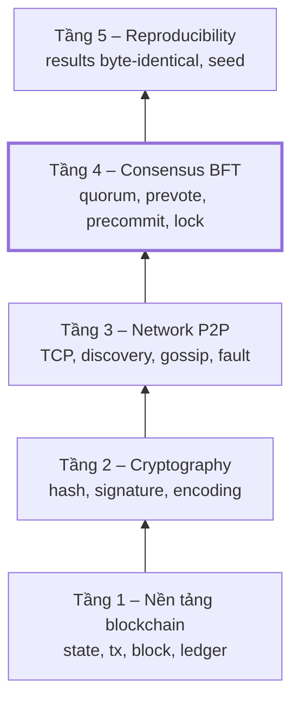

| Tầng | Chủ đề | Câu hỏi nó trả lời | Mức cần hiểu |
| --- | --- | --- | --- |
| 1 | Nền tảng blockchain | Dữ liệu được tổ chức thế nào? | Phải hiểu chắc |
| 2 | Cryptography | Làm sao biết message là thật? | Hiểu ý tưởng, không cần toán |
| 3 | Network P2P | Node tìm nhau, gửi message cho nhau thế nào, mạng hỏng ra sao? | Hiểu neighbor, discovery, gossip, các loại lỗi |
| 4 | Consensus BFT | Làm sao nhiều node đồng ý một block? | Phần khó nhất, đọc 2–3 lần |
| 5 | Reproducibility | Làm sao giảng viên chạy lại ra đúng kết quả của nhóm? | Hiểu nguyên tắc |

Mỗi khái niệm có 3 phần: **là gì**, **vì sao cần**, **trong code Python trông thế nào**. Cuối doc có walk-through một block đi từ đầu đến cuối và một checklist tự kiểm tra: trả lời được hết checklist là đủ để dẫn team.

---

## Tầng 1 – Nền tảng blockchain

Blockchain chỉ là một **danh sách block nối nhau bằng hash**, mỗi block chứa các transaction làm thay đổi một bảng dữ liệu chung (state).

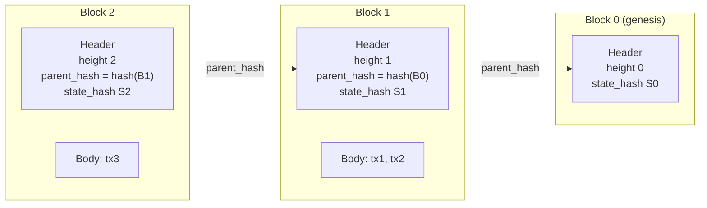

*Mỗi header trỏ ngược về block cha bằng hash. Sửa một block cũ → hash đổi → mọi block sau "đứt xích".*

### State

- **Là gì:** dữ liệu mà cả mạng đồng ý, dạng key–value. Ví dụ `{"Alice/message": "hello", "Bob/message": "hi"}`.
- **Vì sao cần:** đây là "kết quả" của blockchain. Mọi thứ khác tồn tại để mọi node có cùng state này.
- **Python:** một `dict[str, str]`.

### Transaction (tx)

- **Là gì:** một yêu cầu có chữ ký, xin sửa state. Ví dụ: Alice muốn set `Alice/message = "hello"`.
- **Ownership rule:** Alice chỉ được sửa key bắt đầu bằng `Alice/`. Tx sửa `Bob/...` mà ký bởi Alice → invalid.
- **Nonce:** một số đếm tăng dần cho mỗi sender (tx đầu nonce=0, tx sau nonce=1...). Nhờ nonce, cùng một tx gửi 2 lần chỉ được apply 1 lần. Đây chính là test **T4**.
- **Mempool:** hàng chờ của mỗi node, chứa các tx đã nhận nhưng chưa được đưa vào block nào. Proposer lấy tx từ đây để làm block.
- **Python:** `@dataclass Tx(sender, key, value, nonce, signature)`.

Khi một tx tới, node kiểm tra lần lượt (chữ ký là gì: xem Tầng 2):

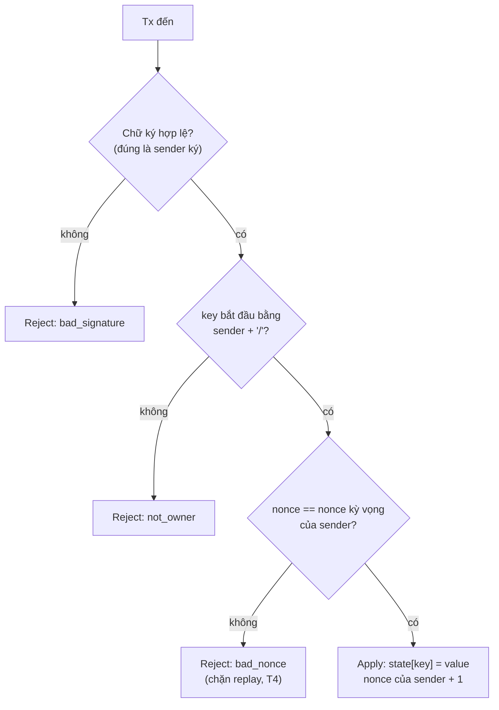

### Block

- **Là gì:** một gói tx có thứ tự, gồm 2 phần:
    - **Header** (nhỏ): `height`, `parent_hash`, `state_hash`, `proposer`, `tx_root` (hash của danh sách tx), chữ ký proposer.
    - **Body** (lớn): danh sách tx.
- **parent_hash** trỏ tới block trước → các block nối thành chuỗi. Sửa 1 block cũ thì hash nó đổi, mọi block sau bị "đứt xích".
- **state_hash** = hash của state *sau khi* apply các tx trong block. Hai node apply cùng block mà ra state_hash khác nhau = có bug determinism.
- **Height:** số thứ tự block (genesis = 0, rồi 1, 2, 3...).

### State transition (hàm chuyển trạng thái)

`new_state = apply(old_state, block.txs)`. Hàm này phải **deterministic**: cùng input → cùng output, trên mọi máy, mọi lần chạy.

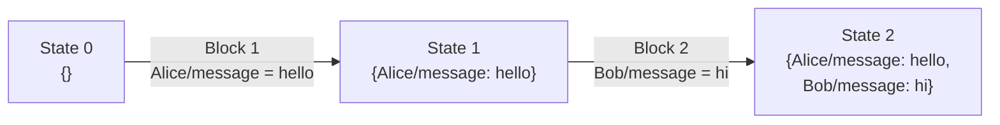

*Node nào apply cùng các block theo cùng thứ tự cũng phải ra đúng State 2 này.*

### Ledger vs View

- **Ledger:** danh sách block **đã finalized**. Chỉ được append, không bao giờ sửa.
- **View:** những gì node đang tin, gồm cả block đang chờ vote (pending). View có thể thay đổi; ledger thì không.

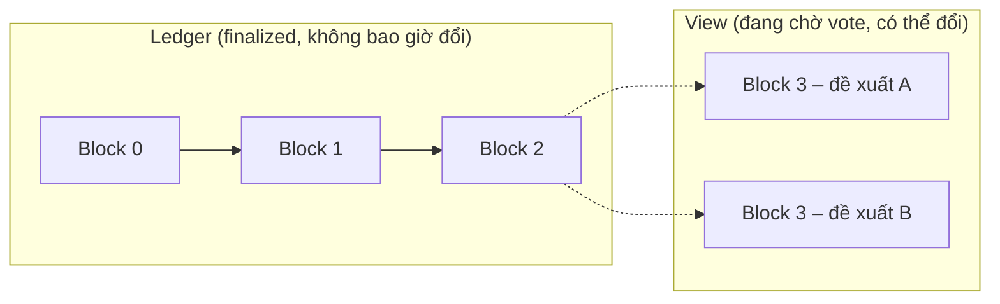

### Finality

Block **finalized** = chắc chắn vĩnh viễn, không bao giờ bị thay. Đây là lời hứa chính của lab: hai honest node không bao giờ có hai block khác nhau finalized ở cùng height.

---

## Tầng 2 – Cryptography

Bạn không cần hiểu toán. Chỉ cần biết mỗi công cụ **làm gì**, **đảm bảo điều gì** và **dùng ở đâu**. Thứ tự đọc: bytes → hash → signature → domain separation.

### Bytes & deterministic encoding (đọc trước tiên)

- **Bytes là gì:** dạng dữ liệu thô mà máy tính thực sự xử lý, một dãy số từ 0 đến 255. Hàm hash và hàm ký **chỉ nhận bytes**, không nhận object Python, dict hay dataclass.
- **Vì vậy:** trước khi hash hay ký một tx/vote, phải **biến object thành bytes**. Việc này gọi là **encode** (hay serialize). Ví dụ:

```python
vote = {"phase": "PREVOTE", "height": 5, "round": 0, "block_hash": "9f2a"}
encode(vote)
# → b'{"block_hash":"9f2a","height":5,"phase":"PREVOTE","round":0}'
#   (chữ b'...' trong Python nghĩa là "đây là bytes")
```

- **Vấn đề:** cùng một object có thể encode ra nhiều kiểu khác nhau. Node A ra `{"a":1,"b":2}`, node B ra `{"b":2,"a":1}`. Dữ liệu giống nhau nhưng **bytes khác nhau**, nên hash khác nhau và chữ ký bị báo sai.
- **Giải pháp:** một hàm duy nhất `encode(obj) -> bytes` cả team dùng chung, luôn sắp xếp key theo cùng thứ tự. Cách đơn giản nhất trong Python: `json.dumps(obj, sort_keys=True, separators=(",", ":"), ensure_ascii=False).encode("utf-8")`. Cách này gọi là **canonical** (chuẩn duy nhất) hay **deterministic encoding**.
- **Quy tắc:** dữ liệu dạng bytes (hash, chữ ký) thì lưu thành chuỗi hex; không dùng `float`; không ai tự viết serialize riêng.

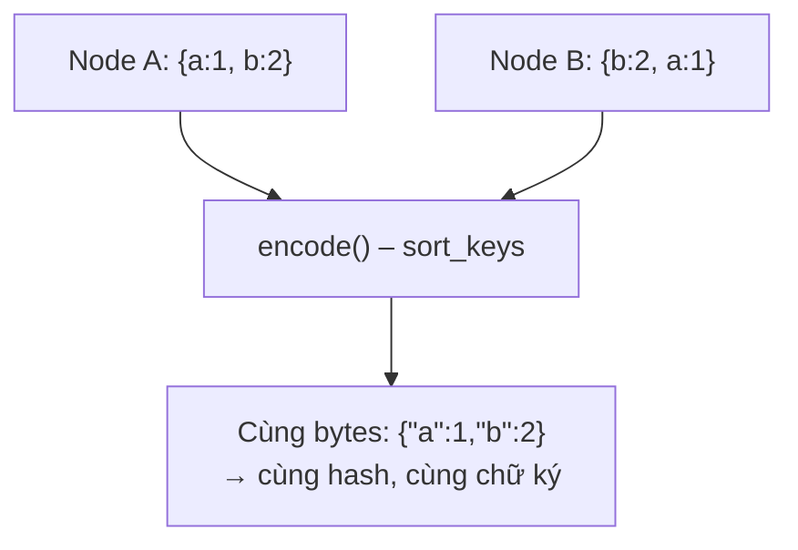

### Hash function (SHA-256)

- **Là gì:** hàm biến bytes bất kỳ thành 32 bytes "vân tay". Đổi 1 ký tự input → hash khác hoàn toàn.
- **Đảm bảo:** không thể tìm 2 input khác nhau có cùng hash (**collision-resistant**). Vì vậy hash đại diện an toàn cho dữ liệu: so 2 hash là biết 2 dữ liệu có giống nhau không.
- **Dùng ở:** block hash, parent_hash, state_hash, tx_root.
- **Python:** `hashlib.sha256(encode(obj)).hexdigest()` (có sẵn, không cần cài).

### Key pair & Digital signature (Ed25519)

**Key pair:** mỗi người (participant như Alice, hoặc validator như V3) có 2 key:

- **Secret key:** chỉ chủ nhân giữ, không bao giờ gửi đi.
- **Public key:** công khai, ai cũng có (trong lab: ghi sẵn trong config lúc khởi động).

**Chữ ký số dùng để làm gì:** chứng minh 2 điều về một message:

1. **Ai gửi:** đúng là Alice, không phải người khác mạo danh.
2. **Không bị sửa:** nội dung y nguyên như lúc Alice gửi.

Chữ ký **không giữ bí mật** message: message vẫn gửi đi dạng đọc được.

**Cách hình dung đơn giản:**

- **`sign()`** ≈ "mã hóa" message bằng secret key của Alice → ra một chuỗi gọi là **chữ ký (signature)**.
- **`verify()`** ≈ "giải mã" chữ ký bằng public key của Alice rồi **so** với message nhận được. Khớp → hợp lệ.

**Vì sao không ai giả được:** muốn làm ra chữ ký mà public key của Alice "giải" ra đúng message, thì phải có secret key của Alice. Chỉ Alice có.

**Vì sao phát hiện được message bị sửa:** chữ ký được làm từ chính nội dung message. Kẻ xấu đổi `hello` thành `bye` mà giữ chữ ký cũ, thì chữ ký "giải" ra `hello`, so với `bye` không khớp. Nó cũng không làm chữ ký mới cho `bye` được, vì không có secret key.

**Trong code:** chỉ gọi 2 hàm có sẵn, không cần biết bên trong tính gì. Lưu ý `verify()` **không trả lại message**, nó tự "giải rồi so" bên trong và chỉ trả về `True`/`False`. Vì vậy bên nhận phải tự encode message nhận được rồi đưa vào:

```python
# Bên gửi (Alice)
sig = sign(secret_key_Alice, encode(tx))

# Bên nhận (mọi node): gửi qua mạng là tx + sig, KHÔNG gửi bytes
ok = verify(public_key_Alice, encode(tx), sig)   # True / False
```

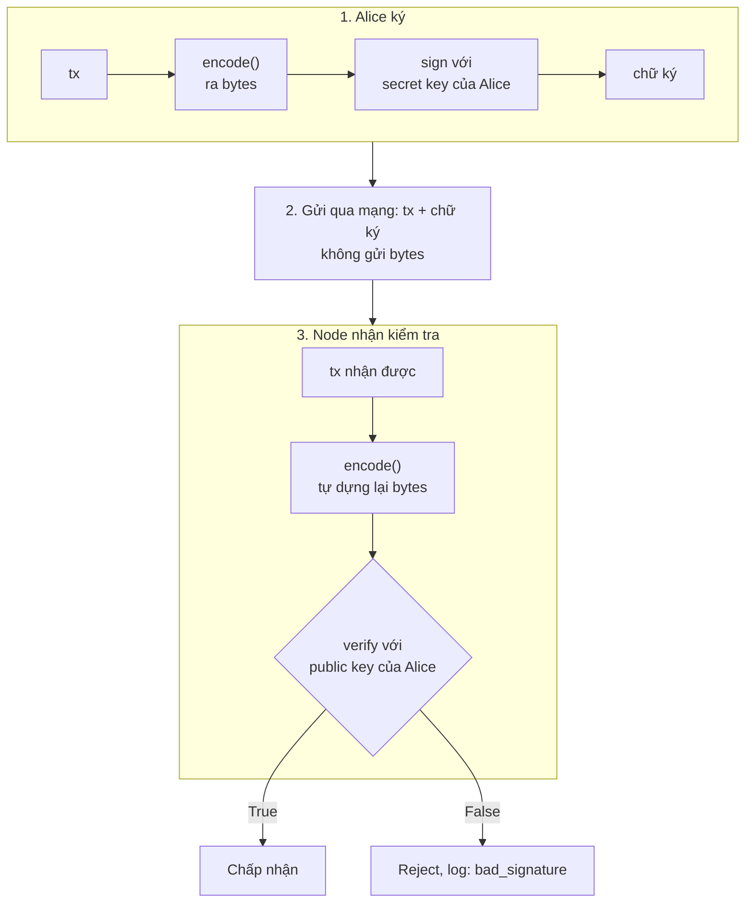

*Hai bên đều tự encode. Vì vậy encode phải ra cùng bytes ở mọi node, nếu không chữ ký thật cũng bị báo sai.*

- **Dùng ở:** tx (participant ký), block header (proposer ký), vote (validator ký).
- **Python:** thư viện `cryptography` hoặc `PyNaCl`. Ed25519 có tính chất: **cùng key + cùng message → luôn ra đúng cùng một chữ ký**. Nhờ vậy chạy lại 2 lần thì log giống hệt nhau (test T8).

### Domain separation

**Nhắc lại một điều:** `verify()` chỉ so **chữ với chữ** (chính xác hơn là bytes với bytes). Nó không hiểu message đó là tx hay vote. Vậy nếu **hai message mang ý nghĩa khác nhau nhưng encode ra giống hệt nhau**, một chữ ký sẽ khớp với cả hai.

**Ví dụ trong lab:** mỗi validator gửi 2 loại vote cho cùng một block:

- **PREVOTE:** "tôi thấy block này hợp lệ" (vòng 1, còn dè dặt).
- **PRECOMMIT:** "tôi chốt block này" (vòng 2, cam kết thật).

Giả sử team quên ghi loại vote vào phần được ký, chỉ ký lên:

```
height=5, round=0, block=9f2a
```

Thì PREVOTE và PRECOMMIT của V3 **viết ra giống hệt nhau**. Chuyện xảy ra:

1. V3 gửi PREVOTE kèm chữ ký. Ý của V3 chỉ là "tôi thấy block hợp lệ".
2. Một node xấu lấy **chính chữ ký đó**, gắn vào message mới và nói: "đây là PRECOMMIT của V3".
3. Node khác chạy `verify()`: chữ ký khớp với `height=5, round=0, block=9f2a`, nên **hợp lệ**.
4. Mọi người tin V3 đã **chốt** block, trong khi V3 chưa hề chốt.

Kẻ xấu **không giả mạo** chữ ký. Nó chỉ **dùng lại một chữ ký thật vào sai chỗ**.

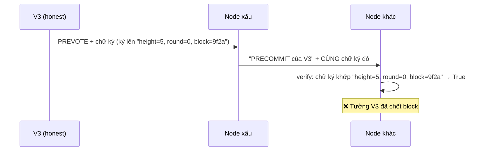

**Cách sửa:** trước khi ký, **ghi nhãn "đây là loại message gì" vào đầu đoạn được ký**:

```
PREVOTE:   height=5, round=0, block=9f2a
PRECOMMIT: height=5, round=0, block=9f2a
```

Giờ hai đoạn khác nhau, nên chữ ký của PREVOTE đem làm PRECOMMIT thì so không khớp, `verify()` trả về `False`. Đó là toàn bộ ý tưởng của **domain separation**: chữ ký của loại này không bao giờ dùng được cho loại khác.

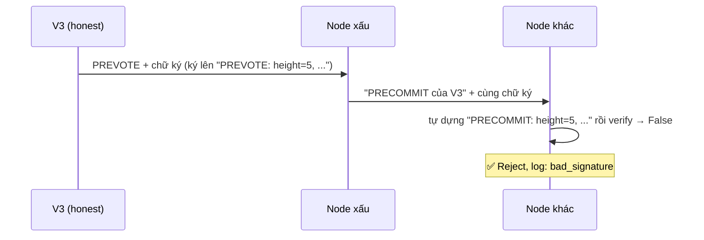

**Áp vào lab:** đề yêu cầu nhãn cho cả 3 loại message được ký. `lab01` là tên chain, cũng là một nhãn, để chữ ký từ chain khác không dùng được ở chain này.

| Loại message | Nhãn ghi ở đầu trước khi ký | Bên trong ghi thêm |
| --- | --- | --- |
| Transaction | `TX:lab01` | sender, key, value, nonce |
| Block header | `HEADER:lab01` | height, round, parent_hash, state_hash, ... |
| Vote | `VOTE:lab01` | **phase (PREVOTE/PRECOMMIT)**, height, round, block_hash |

```python
sig = sign(secret_key, b"VOTE:lab01" + encode(vote))
ok  = verify(public_key, b"VOTE:lab01" + encode(vote), sig)
```

**Cùng ý tưởng, áp cho các field bên trong vote:** ghi `height`, `round`, `block_hash` vào phần được ký để chữ ký của vote ở height 5 không dùng lại được cho height 6, hay vote cho block A không gắn sang được block B. Dùng lại message cũ như vậy gọi là **replay**.

**Test liên quan:** T3. Lấy một chữ ký VOTE đem verify như TX, hoặc chữ ký bị sửa, kết quả phải là bị reject và log lý do.

### State commitment & Merkle tree

- **State commitment:** một hash duy nhất đại diện cho toàn bộ state. Cách đơn giản, hợp lệ cho lab: `sha256(encode(sorted state items))`.
- **Merkle tree (tùy chọn, có thể bỏ qua khi đọc lần đầu):** cây nhị phân, lá là hash từng key–value, node cha là hash của 2 con, root là commitment. Ưu điểm: chứng minh một key có trong state chỉ cần vài hash (**Merkle proof**) thay vì cả state. Lab **không bắt buộc**; nếu làm thì lá phải sort theo key.

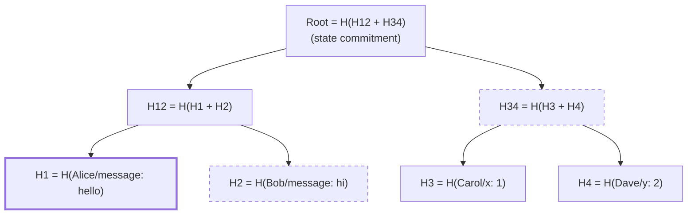

*Merkle proof cho key Alice = H2 và H34 (nét đứt). Verifier tự tính H1 → H12 → Root rồi so với root đã biết.*

---

## Tầng 3 – Network (peer-to-peer)

Network là **peer-to-peer thật**: mỗi node là **một process riêng**, chạy trong một terminal, có port riêng, và nói chuyện với các node **neighbor** của nó bằng TCP. Không có server trung tâm.

Có 2 cách chạy, code giống hệt nhau, chỉ khác địa chỉ IP:

- **Một máy:** 10 terminal, 10 node, cùng IP `127.0.0.1`, port 9000–9009. Thầy đã xác nhận cách này là đủ.
- **Nhiều máy qua ZeroTier:** ví dụ laptop chạy V0–V4, homelab chạy V5–V9. Các máy dùng IP ZeroTier để gọi nhau.

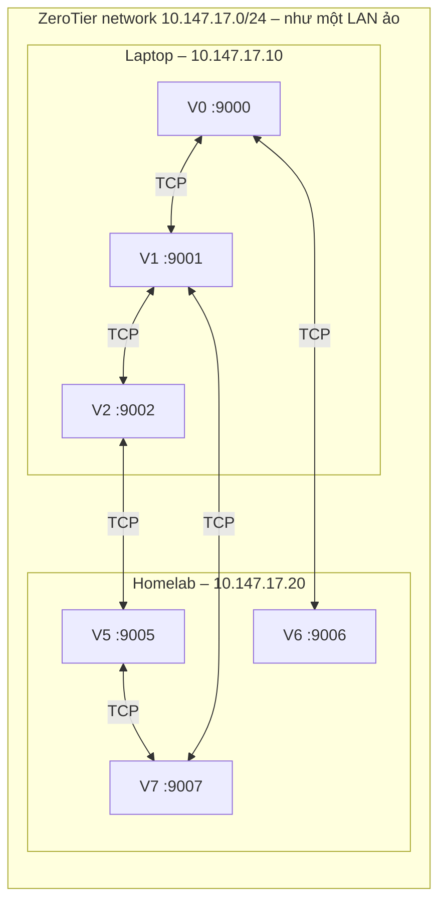

*Mỗi node chỉ giữ TCP connection với vài neighbor, không nối tới tất cả. Node trên laptop và homelab nói chuyện với nhau y như đang chung một LAN.*

### ZeroTier là gì, với code của mình

- **ZeroTier** tạo một **LAN ảo** giữa các máy ở những nơi khác nhau, ví dụ laptop ở trường và homelab ở nhà. Mỗi máy tham gia được cấp một IP trong cùng mạng ảo, ví dụ `10.147.17.10` và `10.147.17.20`, và gọi nhau như đang cắm chung một switch.
- Vì là LAN ảo, ZeroTier hỗ trợ **broadcast và multicast**, điều mà Internet thường không có. Nhóm dùng tính năng này để **tự tìm peer**, xem mục Peer discovery.
- **Với code:** ZeroTier chỉ là "một LAN nữa". Code không cần biết ZeroTier tồn tại; chỉ cần dùng IP ZeroTier làm địa chỉ của node.
- **Thành viên khác** cũng có thể cài ZeroTier và join cùng network, sau khi người quản trị network duyệt. Như vậy ai cũng test được nhiều máy.

### Peer, neighbor và topology

- **Peer:** node khác trong mạng mà mình biết địa chỉ.
- **Neighbor:** peer mà mình **đang giữ TCP connection trực tiếp**. V0 có thể có neighbor là V1, V6, nhưng không nối thẳng tới V5.
- **Topology:** bản đồ "ai nối với ai" của cả mạng.
- **Vì sao không nối tới tất cả:** đó là bản chất P2P. Mạng thật có hàng nghìn node, không ai giữ được connection tới tất cả. Message tới các node xa nhờ **gossip**, xem bên dưới.
- **Mỗi node cần đủ neighbor:** ít nhất f + 1. Nếu một node chỉ có 1 neighbor mà neighbor đó là Byzantine và không chuyển tiếp message, node đó bị cô lập.

### TCP connection & message framing

- **TCP connection:** giống một "đường ống" nối 2 chương trình qua mạng. Bên này ghi bytes vào, bên kia đọc ra đúng thứ tự, không mất, vì TCP tự gửi lại khi mất gói.
- **Framing:** TCP chỉ chuyển một **dòng bytes liên tục**, không biết đâu là ranh giới giữa 2 message. Vì vậy trước mỗi message, ghi **4 bytes cho biết độ dài**, rồi mới tới nội dung là bytes từ `encode()`. Bên nhận đọc 4 bytes, biết cần đọc thêm bao nhiêu bytes nữa là đủ một message.

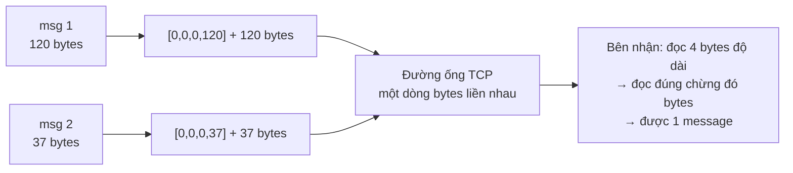

- **Python:** dùng `asyncio`, có sẵn. Một process dùng `asyncio` xử lý được nhiều TCP connection cùng lúc mà không cần tự quản lý thread. Chạy song song thật đến từ việc có nhiều process.

### Peer discovery: node tự tìm nhau

**Vấn đề:** node mới bật lên chỉ biết chính nó. Làm sao nó biết các node khác đang ở IP và port nào?

**Hai câu hỏi tách riêng:**

- **"Ai được tham gia?"** do `config/genesis.json` quyết định: danh sách validator id và public key, cố định suốt lần chạy. Discovery **không** thêm validator mới.
- **"Validator đó đang ở địa chỉ nào?"** do discovery tìm ra lúc chạy.

**Unicast, broadcast, multicast là gì:**

| Kiểu gửi | Gửi tới | Ví dụ |
| --- | --- | --- |
| Unicast | Đúng một máy | TCP connection bình thường |
| Broadcast | Mọi máy trong cùng LAN | Gửi tới `255.255.255.255` |
| Multicast | Mọi máy đã đăng ký nghe một "kênh" | Gửi tới nhóm `239.1.1.1`, ai join nhóm này mới nhận |

Broadcast và multicast **chỉ chạy trong một LAN**, không đi qua Internet. ZeroTier làm các máy thành một LAN ảo, nên chúng chạy được giữa laptop và homelab.

**Nhóm tìm peer bằng multicast beacon:** mỗi node định kỳ gửi một gói UDP nhỏ `ANNOUNCE {node_id, tcp_addr}` có chữ ký tới nhóm multicast. Node nào đang nghe sẽ thêm `node_id → tcp_addr` vào **address book**. Không cần biết trước địa chỉ nào cả.

**Vì sao chỉ cần multicast:** validator set cố định trong genesis, và mọi node luôn nằm trong cùng một LAN: localhost, hoặc LAN ảo ZeroTier. Các blockchain thật chạy qua Internet thì không có multicast, nên phải dùng cách khác như **bootstrap node**: một địa chỉ ghi sẵn để hỏi danh sách peer. Lab này không cần cách đó.

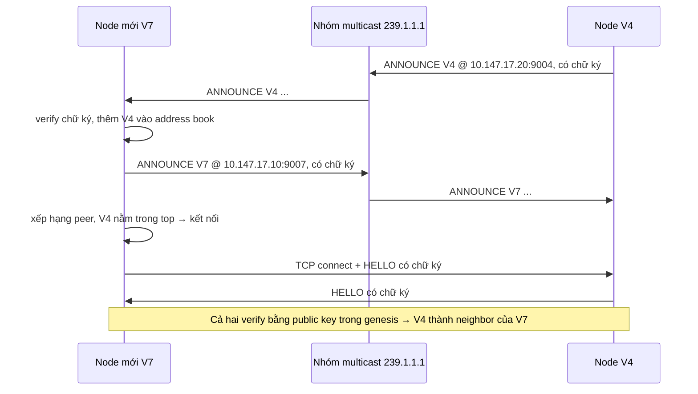

**Quan trọng: multicast chỉ dùng để TÌM PEER, không dùng để gửi vote hay block.** Nếu gửi vote bằng multicast thì mọi node nghe được mọi thứ trực tiếp, không còn neighbor hay gossip, tức là không còn P2P nữa. Thêm nữa, UDP có thể mất gói và không có thứ tự. Mọi message của blockchain đi bằng **TCP tới neighbor + gossip**.

**HELLO handshake:** ngay sau khi mở TCP connection, hai bên gửi `HELLO {node_id, listen_addr, chain_id}` có chữ ký với domain `HELLO:lab01`. Bên nhận verify bằng public key của `node_id` trong genesis. Sai chữ ký, sai `chain_id` hoặc id không có trong genesis → đóng connection, log `reason`. Nhờ vậy Byzantine node không mạo danh được validator khác, kể cả khi nó gửi ANNOUNCE giả.

**Chọn neighbor:** xếp hạng mọi peer trong address book theo `sha256(seed | self_id | peer_id)`, kết nối tới `target_degree` peer đứng đầu, ví dụ 4. Nhận thêm inbound connection tới tối đa `max_degree`.

- **Vì sao dùng hash thay vì chọn ngẫu nhiên hay chọn ai trả lời trước:** cùng seed → cùng topology mỗi lần chạy, kể cả khi thứ tự node bật lên khác nhau. Điều này giúp giảng viên chạy lại ra đúng kết quả, xem Tầng 5. Hash cũng phân bố đều, nên topology giống một random graph, và Byzantine node không tự chọn được vị trí đứng đầu bảng xếp hạng của node khác.

**Neighbor chết:** neighbor mất kết nối quá `peer_timeout` → bỏ, log `peer_removed`, kết nối tới peer xếp hạng tiếp theo, log `peer_added`.

### Gossip: chuyển tiếp message qua neighbor

Vì mỗi node chỉ nối tới neighbor, một message muốn tới **mọi** node thì phải được **chuyển tiếp nhiều chặng**. Cách đơn giản nhất gọi là **gossip kiểu flooding**:

1. Node tạo message như vote, header, tx → gửi cho **mọi neighbor**.
2. Node nhận một message:
    - Đã thấy message này rồi, so theo **message id** = hash của message → **bỏ qua, không chuyển tiếp**.
    - Chưa thấy → ghi nhớ id, xử lý, rồi **gửi tiếp cho mọi neighbor trừ người vừa gửi cho mình**.

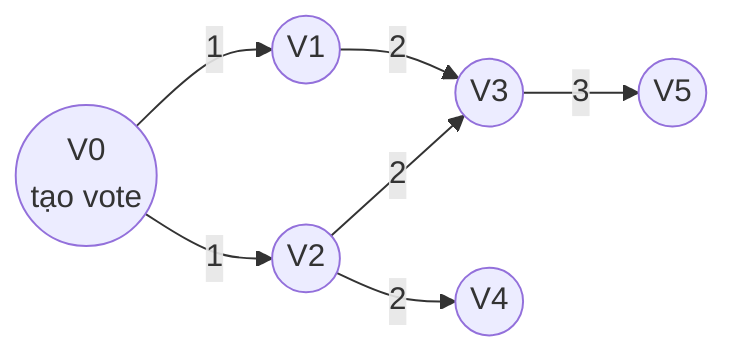

*Số trên mũi tên là chặng thứ mấy. V3 nhận cùng một vote 2 lần, từ V1 và từ V2: lần thứ hai bị bỏ qua nhờ message id, nên message không bị chuyển tiếp vô hạn.*

**Dedup có 2 lớp, đừng nhầm:**

| Lớp | Bỏ trùng theo | Mục đích |
| --- | --- | --- |
| Network, trong gossip | message id = hash của cả message | Không chuyển tiếp một message nhiều lần |
| Consensus, rule 7 | validator, height, round, phase | Không đếm 2 vote của cùng một validator |

### Fault injection: tự tạo mạng không ổn định

Mạng LAN hay ZeroTier thật thường ít khi mất hay trùng gói, nên không đủ để kiểm tra T2 và T5. Vì vậy mỗi node có một **fault injection layer** nằm ngay trước khi gửi qua TCP. Với từng message gửi tới từng neighbor, layer này quyết định: gửi bình thường, **delay** bao lâu, **drop**, hay **duplicate**.

**Quyết định được tính bằng hash, không bằng random tuần tự:**

```
u = sha256(seed | src | dst | message_id) → đổi thành số trong [0, 1)
u < drop_rate          → drop
u < drop_rate + dup    → duplicate
còn lại                → delay theo một phần khác của cùng hash
```

Cùng message trên cùng đường nối luôn có cùng số phận, **bất kể message nào được gửi trước**. Vì sao điều này quan trọng: xem Tầng 5.

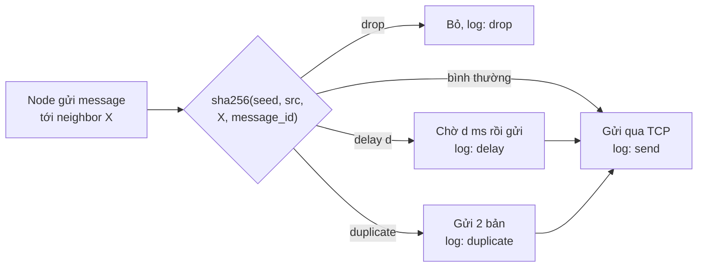

### 4 kiểu lỗi mạng

| Lỗi | Nghĩa | Code phải chịu được bằng cách |
| --- | --- | --- |
| Delay | Message đến trễ | Timeout + round mới |
| Drop | Message mất hẳn | Chờ round sau; gossip qua neighbor khác cũng có thể đưa message tới |
| Duplicate | Một message đến 2 lần | Dedup ở cả 2 lớp, xem bảng trên |
| Reorder | Đến sai thứ tự | Message của height hoặc round mà node chưa tới thì giữ lại, gọi là buffer, tới lượt mới xử lý |

*Reorder không cần tạo riêng: delay khác nhau cho từng message đã tự làm thứ tự bị đảo.*

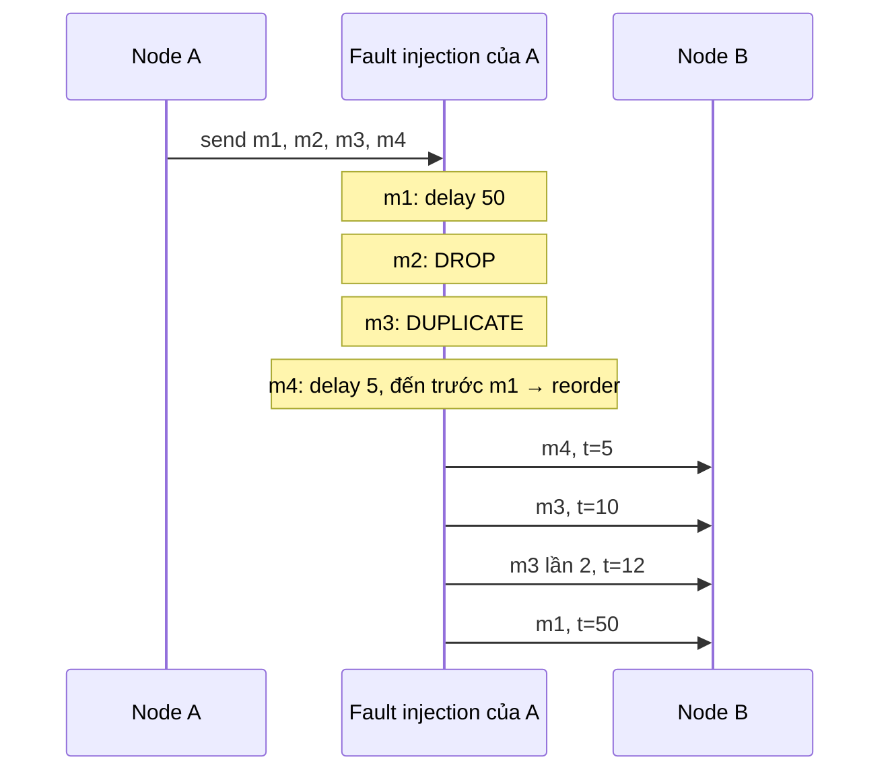

### Partial synchrony

- **Trước GST**, Global Stabilization Time: mạng hỗn loạn tùy ý, không có giới hạn delay.
- **Sau GST:** mọi message giữa honest node đến trong ≤ **∆**, biết trước.
- **Hệ quả thiết kế:** code **không được** dựa vào thời gian để đảm bảo đúng, tức safety; thời gian, tức timeout, chỉ dùng để **tiến lên**, tức liveness.
- **Trong code:** GST tính theo **height** chứ không theo đồng hồ. Scenario có `gst_height`, ví dụ 3: message của height < 3 bị drop/delay nặng; từ height 3 trở đi delay ≤ ∆. Lý do không dùng đồng hồ: các máy khác nhau có đồng hồ lệch nhau, và một message gửi sát mốc GST có thể bị xếp khác nhau giữa 2 lần chạy. Test T5 dùng chính cái này.

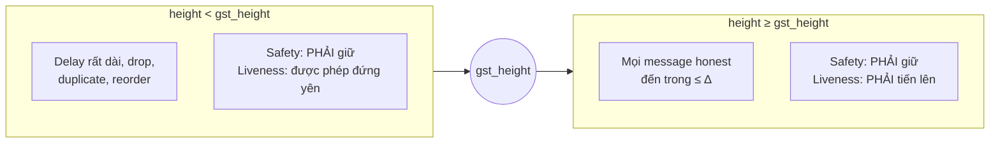

### Header-before-body

Gửi header, vốn nhỏ, trước. Receiver kiểm tra header hợp lệ rồi mới gửi `BODY_REQUEST`; sender mới gửi body. Header sai → không tốn băng thông cho body. Cần 3 loại message: `HEADER`, `BODY_REQUEST`, `BODY`.

Với gossip: receiver xin body từ **neighbor đã gửi header cho mình**. Vì vậy một node **chỉ chuyển tiếp header sau khi chính nó đã có body và kiểm tra xong**, để khi neighbor xin body thì nó có sẵn mà đưa.

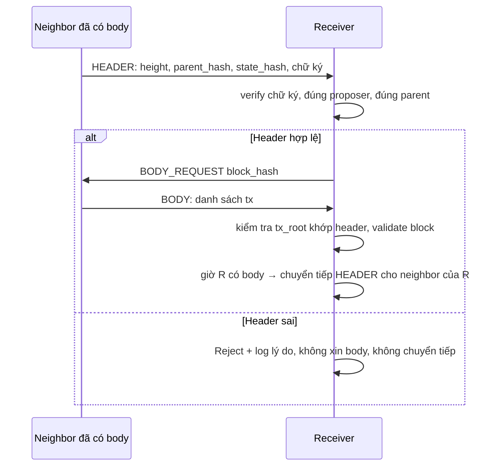

### Block sync: node vào trễ hoặc vừa restart bắt kịp chain

**Vấn đề:** V8 bị tắt lúc chain ở height 3, bật lại lúc các node khác đã ở height 7. V8 chỉ có block 1–3. Nó không vote được cho height 7, vì nó chưa biết block 4–6 nên không kiểm tra được `parent_hash` và state. Nếu không xử lý, V8 sẽ **kẹt mãi** ở height 4. Tình huống tương tự xảy ra khi một node bật lên trễ, sau khi chain đã chạy.

- Chain vẫn chạy tiếp, vì chỉ cần 2f + 1 node hoạt động. Nhưng V8 thì vô dụng cho tới khi bắt kịp.
- **Block sync** là cách V8 bắt kịp: hỏi neighbor "cho tôi các block từ height 4", nhận về block 4–6, kiểm tra, apply, rồi tham gia consensus ở height 7.
- **Không cần tin neighbor:** mỗi block gửi kèm **commit certificate** = 2f + 1 PRECOMMIT có chữ ký cho block đó. V8 tự verify các chữ ký; nếu đủ quorum thì block đó chắc chắn đã được finalize. Neighbor Byzantine không làm giả được certificate, vì không giả được chữ ký của honest validator.
- **Liên hệ slides:** đây là phiên bản nhỏ của **full sync** trong slide về synchronization modes: replay các block từ peer và tự verify từng block.

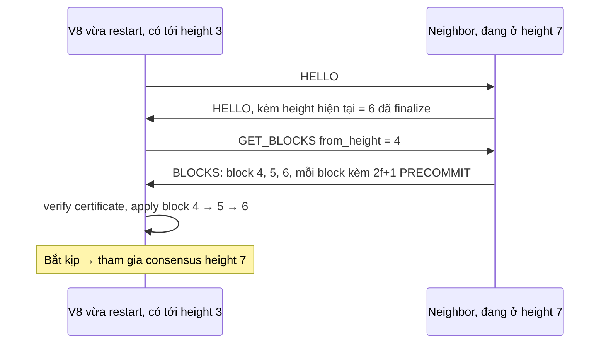

### Rate limit & peer blocking

Mỗi node chỉ gửi tối đa N message mỗi đơn vị thời gian, gọi là outbound rate limit. Neighbor nào gửi tới quá nhiều → tạm **block** một thời gian rồi **unblock**. Mọi sự kiện này phải được log.

**Chiều nhận**, mỗi message tới từ một neighbor:

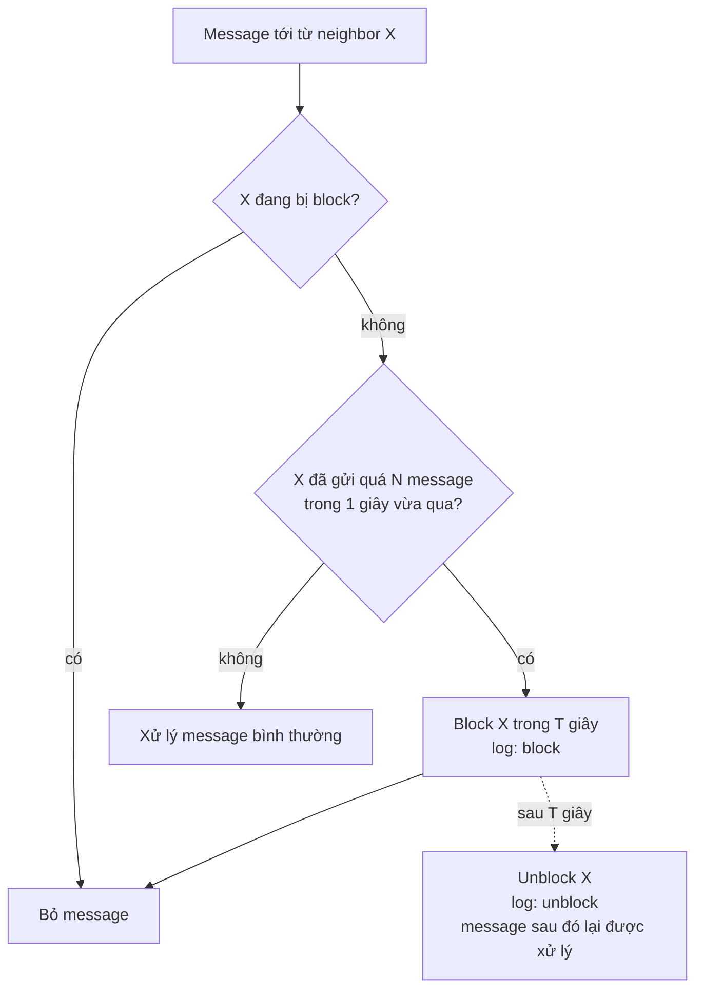

**Chiều gửi**, outbound rate limit:

```mermaid
flowchart LR
    SEND["Node muốn gửi message<br/>tới neighbor X"] --> Q{"Đã gửi tới X đủ N message<br/>trong 1 giây vừa qua?"}
    Q -- "chưa" --> GO["Gửi ngay"]
    Q -- "đủ rồi" --> WAIT["Xếp hàng chờ<br/>sang giây tiếp theo mới gửi"]
```

### Network event log

Mỗi node tự ghi file log của mình. Các event `send`, `deliver`, `drop`, `delay`, `duplicate`, `block`, `unblock`, `peer_added`, `peer_removed` mỗi cái ghi 1 dòng: `time, node_id, event_type, height, ...`. Log là **bằng chứng** chấm điểm.

---

## Tầng 4 – Consensus BFT

Consensus trả lời một câu: **ở height h, block nào được finalize?** Lab dùng thuật toán kiểu **Tendermint**: mỗi height có thể cần nhiều round, mỗi round có 3 bước Propose → Prevote → Precommit.

### Byzantine & n = 3f + 1

- **Honest (correct) node:** node chạy đúng code của team, làm đúng mọi luật.
- **Byzantine validator:** node có thể làm bất cứ điều gì xấu: im lặng, gửi trùng, gửi 2 vote mâu thuẫn (**equivocation**), propose block sai, replay message cũ. Nhưng không giả được chữ ký người khác (Tầng 2).
- **n = 3f + 1:** n validator, tối đa f kẻ xấu. Team chọn n có đúng dạng 3f + 1 để công thức quorum 2f + 1 dùng thẳng được, không phải tính lại. **Team Plan đã chốt n = 10, f = 3, quorum = 7** (đề yêu cầu ≥ 8 node).
- **Lưu ý:** các ví dụ trong tài liệu này dùng n = 4 hoặc n = 7 cho số nhỏ, dễ theo dõi. Cơ chế giống hệt với n = 10.

| n | f | quorum 2f+1 |
| --- | --- | --- |
| 4 | 1 | 3 |
| 7 | 2 | 5 |
| 10 | 3 | 7 |

### Quorum = 2f + 1

Cần **ít nhất 2f + 1 vote** (hơn 2/3) mới được tính là "đa số". Vì sao an toàn?

- Hai quorum bất kỳ (mỗi cái 2f+1) trong n = 3f+1 node phải chồng lên nhau ít nhất **f + 1** node. Phép tính: (2f+1) + (2f+1) − (3f+1) = f + 1.
- Trong f + 1 node đó, tối đa f là Byzantine, nên có ít nhất **1 honest node**.
- Honest node không bao giờ vote 2 block khác nhau trong cùng round → **không thể có 2 block cùng đạt quorum**.

Ví dụ n = 4 (V0, V1, V2, V3), f = 1, quorum = 3. Giả sử block A đạt quorum nhờ {V0, V1, V2}. Muốn block B cũng đạt quorum thì cần 3 vote khác, nhưng chỉ còn V3 chưa dính tới A. Vì vậy B bắt buộc phải lấy thêm 2 node đã vote A, ví dụ {V1, V2, V3}.

```mermaid
flowchart LR
    subgraph OnlyA["Chỉ vote A"]
        V0((V0))
    end
    subgraph Both["Phải vote CẢ A lẫn B"]
        V1((V1))
        V2((V2))
    end
    subgraph OnlyB["Chỉ vote B"]
        V3((V3))
    end
    QA["Quorum A = V0, V1, V2"] --> OnlyA
    QA --> Both
    QB["Quorum B = V1, V2, V3"] --> Both
    QB --> OnlyB
    style Both stroke-width:3px
```

*V1 và V2 phải vote cả A lẫn B. Chỉ có 1 Byzantine, nên ít nhất một trong hai là honest, mà honest không bao giờ vote 2 block cùng round. Vì vậy A và B không thể cùng đạt quorum.*

**Công thức trong code:** `quorum = n − f` với `f = (n − 1) // 3`. Khi n = 3f + 1 thì n − f = 2f + 1, nên hai cách viết cho cùng kết quả, ví dụ n = 10 thì cả hai đều là 7. Code dùng n − f vì nó vẫn an toàn khi n **không** có dạng 3f + 1. Ví dụ n = 8: f = 2, nếu dùng 2f + 1 = 5 thì hai nhóm 5 node trong 8 node chỉ chắc chắn chung nhau 5 + 5 − 8 = 2 node, mà cả 2 có thể là Byzantine, nên **không an toàn**. Dùng n − f = 6 thì hai nhóm chung nhau ít nhất 6 + 6 − 8 = 4 node, nhiều hơn f, nên luôn có ít nhất một honest node chung.

### Safety vs Liveness

- **Safety** = "điều xấu không bao giờ xảy ra": không bao giờ 2 block khác nhau finalized ở cùng height. **Phải đúng mọi lúc**, kể cả mạng tệ.
- **Liveness** = "điều tốt cuối cùng sẽ xảy ra": chain tiếp tục finalize block mới. Chỉ cần đúng **sau GST**.
- Khi phải chọn: hy sinh liveness (đứng yên chờ), **không bao giờ** hy sinh safety.

```mermaid
flowchart TD
    Q{"Mạng đang tệ,<br/>chưa đủ vote"} --> A1["Đứng yên, chờ timeout,<br/>sang round mới<br/>(mất liveness tạm thời) ✅"]
    Q --> A2["Finalize đại block<br/>đang có<br/>(mất safety) ❌"]
```

### Height, Round, Proposer

- **Height:** vị trí block trong chain (đang quyết block số mấy).
- **Round:** lần thử thứ mấy ở height đó. Round 0 thất bại (proposer chết, mạng chậm) → round 1, 2...
- **Proposer:** node được quyền đề xuất block ở round đó. Cách chọn deterministic đơn giản: `validators[(height + round) % n]`. Mọi node tự tính ra cùng proposer, không cần hỏi nhau.

```mermaid
flowchart LR
    subgraph H3["Height 3"]
        R0["Round 0<br/>proposer V3<br/>❌ timeout"] --> R1["Round 1<br/>proposer V4<br/>✅ finalize"]
    end
    subgraph H4["Height 4"]
        R40["Round 0<br/>proposer V4"]
    end
    R1 --> R40
```

*(Ví dụ n = 7: proposer = validators[(height + round) % 7].)*

### Một round gồm 3 bước

1. **Propose:** proposer tạo block, ký header, broadcast.
2. **Prevote:** mỗi validator kiểm tra block (rule 3: parent đúng, tx hợp lệ, state_hash đúng, đúng proposer, chữ ký đúng).
    - Hợp lệ → ký `PREVOTE(h, r, block_hash)`.
    - Không hợp lệ hoặc hết giờ chờ → ký `PREVOTE(h, r, NIL)`.
3. **Precommit:** khi thấy **≥ 2f+1 PREVOTE cho cùng block B** (gọi là **polka**):
    - **Lock** B (ghi nhớ `locked_block = B`, `locked_round = r`).
    - Ký `PRECOMMIT(h, r, B)`.
    - Nếu hết giờ mà không có polka → `PRECOMMIT(h, r, NIL)`.
4. **Commit:** khi thấy **≥ 2f+1 PRECOMMIT cho cùng B** → B **finalized**. Apply vào ledger, sang height h+1, round 0.
5. Nếu round kết thúc mà không commit → **timeout** → round r+1, proposer mới.

```mermaid
flowchart TD
    S["Round r bắt đầu"] --> P["Proposer gửi block"]
    P --> PV["PREVOTE B hoặc NIL"]
    PV --> PK{"Polka?<br/>≥ 2f+1 PREVOTE cho B"}
    PK -- có --> LK["Lock B<br/>PRECOMMIT B"]
    PK -- không --> PN["PRECOMMIT NIL"]
    LK --> CM{"≥ 2f+1 PRECOMMIT B?"}
    PN --> TO
    CM -- có --> FIN["FINALIZE B ✅"]
    CM -- "không / hết giờ" --> TO["Timeout → round r+1<br/>proposer mới"]
    TO --> S
    FIN --> NH["Height h+1, round 0"]
    NH --> S
    style FIN stroke-width:3px
```

*Mọi nhánh "không" đều dẫn tới timeout và round mới, không bao giờ tới Finalize.*

Cùng một round nhìn theo thời gian, từ góc của V0 (n = 4, quorum = 3). Mọi node đều broadcast vote cho tất cả; diagram chỉ vẽ các vote đi tới V0 cho gọn:

```mermaid
sequenceDiagram
    participant V0 as V0 (proposer)
    participant V1
    participant V2
    participant V3
    V0->>V1: PROPOSAL B
    V0->>V2: PROPOSAL B
    V0->>V3: PROPOSAL B
    Note over V0,V3: Mỗi node tự validate B
    V1->>V0: PREVOTE B
    V2->>V0: PREVOTE B
    V3->>V0: PREVOTE B
    Note over V0: Có 4 PREVOTE B (gồm của chính V0) ≥ 3 → polka → lock B
    V1->>V0: PRECOMMIT B
    V2->>V0: PRECOMMIT B
    V3->>V0: PRECOMMIT B
    Note over V0: Có 4 PRECOMMIT B ≥ 3 → FINALIZE B
```

### Hai phase để làm gì?

Prevote = "tôi thấy block này hợp lệ". Precommit = "tôi biết **đa số** cũng thấy nó hợp lệ". Có 2 phase thì một node chỉ cam kết khi chắc chắn những node khác cũng đang đi theo hướng đó.

### Locking – phần quan trọng nhất cho safety

- **Vấn đề nếu không lock:** round 0, precommit cho B đủ quorum ở **vài** node nên vài node đã finalize B, nhưng message tới node khác bị mất. Round 1 có proposer mới đề xuất C. Nếu mọi người vote C thoải mái → C cũng finalize → **2 block ở cùng height**. Thảm họa.
- **Rule 4–5:** khi đã lock B, validator **chỉ prevote B** ở các round sau. Chỉ được đổi sang block khác nếu thấy **polka (2f+1 prevote) cho block khác đó ở round mới hơn** `locked_round`.
- **Kết quả:** một khi B có thể đã được finalize ở đâu đó, đủ nhiều honest node đã lock B để không block nào khác đạt quorum.

Kịch bản lỗi nếu **không có** lock:

```mermaid
sequenceDiagram
    participant X as Một số node
    participant Y as Các node còn lại
    Note over X,Y: Round 0
    X->>X: Đủ quorum PRECOMMIT B → FINALIZE B
    X--xY: PRECOMMIT B bị mất trên mạng
    Note over Y: Không thấy quorum → timeout
    Note over X,Y: Round 1, proposer mới đề xuất C
    Y->>Y: (không lock) prevote C, precommit C
    Y->>Y: FINALIZE C
    Note over X,Y: ❌ B và C cùng finalized ở height h
```

Một validator đã lock B quyết định prevote thế nào ở các round sau:

```mermaid
flowchart TD
    U["Unlocked<br/>chưa lock block nào ở height này"] -- "thấy polka cho B ở round r" --> LB["Locked B<br/>locked_block = B, locked_round = r"]
    LB --> Q{"Round mới:<br/>proposal là block nào?"}
    Q -- "vẫn là B" --> PB["Prevote B"]
    Q -- "block khác, C" --> Q2{"Có polka cho C ở round<br/>mới hơn locked_round?"}
    Q2 -- "không" --> PN["Prevote NIL<br/>vẫn giữ lock B"]
    Q2 -- "có" --> LC["Đổi lock sang C<br/>locked_round = round đó<br/>prevote C"]
    FIN["Block của height này được finalize"] -- "sang height mới, xóa lock" --> U2["Unlocked ở height mới"]
```

### Locking chi tiết: vì sao lock phải giữ qua nhiều round

**Lock không "chờ" gì cả.** Lock là điều node **ghi nhớ**: "ở round r, tôi đã thấy polka cho B". Lock được giữ **suốt cả height**, qua nhiều round, và chỉ thay đổi trong 2 trường hợp:

1. **Height được finalize** → sang height mới, **xóa lock**.
2. **Thấy polka cho block khác ở một round mới hơn `locked_round`** → **đổi lock** sang block đó.

#### Phản ví dụ: nếu bỏ lock mỗi khi sang round mới

n = 4, f = 1, quorum = 3.

**Round 1:**
- V0, V1, V2 prevote B → **polka B** → cả ba lock B và precommit B.
- V0 nhận đủ 3 precommit → **V0 finalize B**.
- V1, V2 bị drop precommit, chỉ thấy 2 → **timeout**, sang round 2.

**Round 2, nếu bỏ lock:** proposer đề xuất C. V1, V2, V3 không còn lock gì → cả ba prevote C → **polka C** → precommit C → **V1, V2, V3 finalize C**. V0 đã finalize **B**, còn V1, V2, V3 finalize **C** ở cùng height → **mất safety**.

**Round 2, nếu giữ lock:** V1, V2 vẫn lock B, chưa có polka C nào mới hơn round 1 → prevote **NIL**. C tối đa có V3 cộng 1 Byzantine, tức 2 phiếu, nhỏ hơn 3 → **C không bao giờ được finalize** → safety được giữ.

```mermaid
sequenceDiagram
    participant V0
    participant V12 as V1, V2
    participant V3
    Note over V0,V3: Round 1
    V0->>V0: polka B, lock B, precommit B
    V12->>V12: polka B, lock B, precommit B
    V0->>V0: nhận đủ 3 precommit → FINALIZE B
    V12--xV12: precommit bị drop, chỉ thấy 2 → timeout
    Note over V0,V3: Round 2, proposer đề xuất C
    alt Bỏ lock khi sang round mới
        V12->>V3: prevote C
        V3->>V12: prevote C
        Note over V0,V3: polka C → V1, V2, V3 finalize C ❌ trong khi V0 đã finalize B
    else Giữ lock như thiết kế
        V12->>V3: prevote NIL, vì đang lock B
        Note over V0,V3: C tối đa 2 phiếu < 3 → không finalize được ✅
    end
```

**Vì sao lock phải sống qua nhiều round:** lock tồn tại để trả lời nỗi lo *"có thể đã có node nào đó finalize B rồi, chỉ là tôi không biết"*. Nỗi lo này **không biến mất khi sang round mới**: ở round 2, V1 vẫn không biết V0 đã finalize B. Nó chỉ được bỏ lời hứa khi có bằng chứng an toàn:
- Height đã finalize.
- Thấy **polka mới hơn cho block khác**: nếu B đã được finalize thì ít nhất f + 1 honest node đang lock B và sẽ không prevote block khác, nên block khác **không thể** có polka. Vậy thấy polka mới cho block khác nghĩa là B chắc chắn chưa được finalize.

#### Ba mốc round khi quyết định prevote

- **`locked_round`**: round trong **quá khứ** mà mình đã lock B. Không phải round hiện tại.
- **`r`**: round **hiện tại**.
- **`r_p`**: round mà mình **thấy polka cho block P**.

| Round | Chuyện xảy ra với V5 | Lock của V5 |
| --- | --- | --- |
| 1 | Thấy polka B → lock B. Precommit không đủ → timeout → sang round 2 | B, `locked_round = 1` |
| 2 | Proposal là C. Đang lock B, chưa thấy polka C → prevote NIL. Prevote của người khác tới chậm → timeout → precommit NIL → sang round 3 | vẫn B |
| 2, tới trễ | Đang ở round 3 thì prevote cho C của round 2 mới tới. V5 **vẫn lưu và đếm**: đủ 2f + 1 → biết đã có polka C ở round 2 | vẫn B |
| 3 | Proposal là C. `polka_round(C) = 2 > locked_round = 1` → **được prevote C**; khi thấy polka C ở round 3 thì đổi lock sang C | C, `locked_round = 3` |

Quy tắc gọn để code. Vế `r_p < r` luôn tự đúng, vì polka của round hiện tại cần chính prevote của round hiện tại:

```python
if locked_block is not None and P != locked_block:
    if polka_round(P) > locked_round:
        prevote(P)
    else:
        prevote(NIL)
```

#### Timeout không xóa lock, không xóa vote

- Timeout chỉ kết thúc **lượt thử của round đó** để sang round mới, giúp chain không đứng yên.
- **Lock** giữ suốt height. **Vote** của mọi round trong height hiện tại được lưu trong `VoteSet` theo `(height, round, phase)`; vote của round cũ tới trễ **vẫn được đếm**. Chỉ xóa khi sang height mới.

#### Hai mốc quorum, nhắc lại cho đúng

1. **2f + 1 PREVOTE cho B ở round r** → được phép **PRECOMMIT B** và lock B. Precommit đi theo **polka mà node thấy**, không theo prevote của chính nó.
2. **2f + 1 PRECOMMIT cho B ở cùng một round r'** → **finalize B**. r' là **bất kỳ round nào** của height hiện tại, và điều kiện này **không phụ thuộc lock của mình**.

### Vote rules cần code (section 6.1)

| Rule | Nội dung | Cách code |
| --- | --- | --- |
| 1–2 | Tối đa 1 PREVOTE và 1 PRECOMMIT mỗi (height, round) | Lưu `signed_votes[(h, r, phase)]`, đã ký thì không ký nữa |
| 3 | Chỉ prevote block hợp lệ | Hàm `validate_block()` |
| 4 | Thấy polka → lock | `locked_block`, `locked_round` |
| 5 | Đã lock chỉ đổi khi có polka mới hơn | Kiểm tra trước khi prevote |
| 6 | Không ký vote sai chain/height/round/phase/domain | Kiểm tra trong hàm `sign_vote()` |
| 7 | Bỏ duplicate, mỗi validator chỉ đếm 1 vote | `votes[(h, r, phase)][validator_id] = vote` |

Một vote đến sẽ đi qua các bước sau trước khi được đếm:

```mermaid
flowchart TD
    A["Vote đến"] --> B{"Chữ ký hợp lệ<br/>(domain VOTE)?"}
    B -- không --> R1["Reject: bad_signature / wrong_domain"]
    B -- có --> C{"Voter có trong<br/>validator set?"}
    C -- không --> R2["Reject: unknown_validator"]
    C -- có --> D{"Đã có vote của voter này<br/>cho (h, r, phase)?"}
    D -- "chưa" --> ADD["Lưu: votes[(h,r,phase)][voter] = vote<br/>→ đếm"]
    D -- "có, giống hệt" --> DUP["Bỏ qua: duplicate_ignored"]
    D -- "có, khác block" --> EQ["Không đếm<br/>log: equivocation_detected"]
```

### Timeout

Mỗi bước có timeout (ví dụ `propose_timeout`). Hết giờ thì vote NIL hoặc sang round mới. Timeout tăng dần theo round (ví dụ `base + r * delta`) để sau GST chắc chắn có round đủ dài. Đây là test **T6** (proposer chết).

### Equivocation

Byzantine gửi `PREVOTE(h, r, A)` cho một nửa mạng và `PREVOTE(h, r, B)` cho nửa còn lại. Code của mình: giữ vote **đầu tiên** của validator đó, log vote thứ hai là equivocation, không đếm. Vì quorum là 2f+1, f kẻ xấu không đủ để kéo cả A và B lên quorum. Đây là test **T7**.

```mermaid
flowchart LR
    BZ(("Byzantine Vx"))
    BZ -- "PREVOTE A" --> G1["Nhóm 1"]
    BZ -- "PREVOTE B" --> G2["Nhóm 2"]
    G1 --> K["Khi hai vote cùng tới một node:<br/>giữ vote đầu, log equivocation"]
    G2 --> K
```

---

## Tầng 5 – Determinism & reproducibility

**Yêu cầu T8, theo giải thích của thầy:** mục tiêu của "byte-identical" là khi thầy chạy lại thì ra **đúng kết quả nhóm đã nộp**, để không có tranh cãi. Timestamp và thứ tự event được phép khác nhau giữa các lần chạy; ngoài timestamp, hầu như luôn làm được scenario byte-identical.

### Vì sao chạy 2 lần lại có thể ra khác nhau

10 process chạy song song trên network thật. Thời điểm một message tới phụ thuộc vào CPU, hệ điều hành, mạng; lần này V3 nhận vote của V1 trước vote của V2, lần sau thì ngược lại. Hệ quả:

- **Timestamp và thứ tự dòng trong log** gần như chắc chắn khác nhau. Thầy chấp nhận điều này.
- **Kết quả** như block nào được finalize, ở round nào, state hash là gì, **có thể** khác nhau nếu code để timing ảnh hưởng tới quyết định. Đây là thứ phải chặn.

### Tách output làm 2 loại

| Output | Nằm ở | Có timestamp | Yêu cầu |
| --- | --- | --- | --- |
| Event log | `logs/<scenario>/<node>.jsonl` | Có | Để debug, làm bằng chứng; được phép khác nhau |
| Results | `logs/results/<scenario>/<node>.json` + `verdict.json` | Không | **Byte-identical** giữa mọi lần chạy, trên mọi máy |

**Results của mỗi node** gồm: finalized chain với `height, round, proposer, block_hash, state_hash`, final state hash, số lần reject theo từng reason, danh sách equivocation phát hiện được, neighbor set. Mọi thứ ghi bằng `encode()`, nên cùng nội dung thì cùng bytes.

### Loại bỏ từng nguồn khác biệt

| Nguồn khác biệt | Cách loại bỏ |
| --- | --- |
| Key sinh ngẫu nhiên | Sinh từ seed: `keypair_from_seed(seed, node_id)` |
| Tx tới mempool lúc nào | Client gửi toàn bộ tx của scenario trong lúc warmup, trước height 1; mempool lấy tx theo `(sender, nonce)` |
| Topology | Chọn neighbor bằng `sha256(seed, self, peer)`, xem Tầng 3 |
| Message nào bị drop, duplicate, delay bao lâu | Tính bằng hash của message, không bằng random tuần tự, xem bên dưới |
| Ranh giới GST | Theo height, không theo đồng hồ |
| Message vừa kịp hay vừa trễ timeout | Delay hai cực, xem bên dưới |
| Byzantine làm gì | Ghi rõ trong scenario: node nào, height nào, làm gì |
| Thứ tự duyệt `set` / `dict` | `sorted(...)` trước khi duyệt |
| Hàm `hash()` của Python, `id(obj)` | Không dùng cho bất cứ thứ gì vào results, chain hay gửi qua network |
| Phiên bản thư viện | Ghi version cố định cho mọi dependency |

### Vì sao random tuần tự không được, còn hash thì được

**Random tuần tự:** `rng.random()` trả số tiếp theo trong một dãy cố định. Lần gọi thứ 1 luôn ra cùng số, lần thứ 2 luôn ra cùng số, v.v. Vấn đề: **message nào được gọi `rng` trước phụ thuộc vào timing**. Lần chạy 1, vote A gọi trước và bị drop; lần chạy 2, vote B gọi trước nên vote B bị drop. Cùng seed mà kết quả khác.

**Hash của message:** `sha256(seed, src, dst, message_id)` chỉ phụ thuộc vào chính message đó. Vote A trên đường V1 → V3 **luôn** có cùng số phận, bất kể nó được xử lý trước hay sau message khác.

```mermaid
flowchart TD
    subgraph Seq["❌ rng tuần tự"]
        S1["Lần 1: A gọi trước → số thứ 1 → drop A"]
        S2["Lần 2: B gọi trước → số thứ 1 → drop B"]
    end
    subgraph Hash["✅ hash của message"]
        H1["Lần 1: hash(A) → drop A, hash(B) → gửi B"]
        H2["Lần 2: hash(B) → gửi B, hash(A) → drop A"]
    end
```

### Delay hai cực: tránh "vừa kịp, vừa trễ"

Giả sử timeout là 1000 ms và một vote bị delay 995 ms. Lần chạy 1, CPU nhanh, vote tới ở 998 ms: kịp. Lần chạy 2, CPU bận, vote tới ở 1003 ms: trễ, node vote NIL, kết quả khác hẳn.

**Cách tránh:** delay chỉ nằm ở **hai cực**, không bao giờ ở gần timeout:

- **Delay ngắn:** ≤ 10% timeout, cộng cả độ trễ thật của mạng vẫn chắc chắn tới kịp.
- **Delay dài:** ≥ 2× timeout, chắc chắn tới trễ, giả lập "mạng hỗn loạn trước GST".

```mermaid
flowchart LR
    A["0 ms"] --> B["Vùng delay ngắn<br/>0 – 100 ms<br/>chắc chắn kịp"]
    B --> C["Vùng cấm<br/>100 – 2000 ms<br/>không bao giờ chọn"]
    C --> D["Vùng delay dài<br/>≥ 2000 ms<br/>chắc chắn trễ"]
    style C stroke-dasharray: 5 5
```

*Ví dụ với timeout 1000 ms. Khi chạy qua ZeroTier, độ trễ thật giữa 2 máy cũng phải nằm gọn trong vùng ngắn; kiểm tra bằng `ping` trước khi chọn timeout.*

### Kiểm tra: chạy 2 lần, so results

```mermaid
flowchart LR
    SC["Scenario config<br/>seed, tx, fault, Byzantine"] --> R1["Lần chạy 1"]
    SC --> R2["Lần chạy 2"]
    SC --> R3["Lần chạy của thầy"]
    R1 --> O1["logs/results/ 1"]
    R2 --> O2["logs/results/ 2"]
    R3 --> O3["logs/results/ của thầy"]
    O1 --> CMP{"byte-identical?"}
    O2 --> CMP
    O3 --> CMP
    CMP -- có --> OK["T8 PASS"]
    CMP -- không --> BAD["Diff results, đối chiếu<br/>bảng nguồn khác biệt"]
```

Results giống nhau dù chạy trên 1 máy hay 2 máy qua ZeroTier, vì không có thứ gì trong results phụ thuộc vào máy hay timing. Đây cũng là một điểm mạnh để trình bày khi vấn đáp.

### Những thứ phá determinism trong Python

| Kẻ phá | Thay bằng |
| --- | --- |
| `random.random()` để quyết định fault | Hash của `(seed, src, dst, message_id)` |
| `time.time()` để quyết định GST | `gst_height` |
| Duyệt `set` / dict khi thứ tự quan trọng | `sorted(...)` trước khi duyệt |
| `id(obj)`, `hash(str)` của Python, bị random hóa mỗi lần chạy | SHA-256 của nội dung |
| Sinh key ngẫu nhiên mỗi lần chạy | `keypair_from_seed(seed, node_id)` |
| `json.dumps` thiếu `sort_keys` | Hàm `encode()` chung |
| Ghi timestamp vào results | Timestamp chỉ ghi vào event log |

`time` và `asyncio` vẫn được dùng bình thường cho timeout và network. Chúng chỉ không được **quyết định** điều gì đi vào results.

### Lưu ý về "Random seeds không phải cryptographic randomness"

Đề nói seed không phải nguồn random an toàn cho crypto. Sinh key từ seed là **chấp nhận được cho lab**, vì nó giúp reproduce, nhưng nên ghi rõ trong REPORT rằng ngoài đời thật phải dùng `os.urandom` hoặc `secrets`.

---

## Liên hệ với slides

Slides là "bức tranh lớn" về node ngoài đời thật. Lab chỉ làm phần lõi. Bảng dưới cho biết phần nào **phải làm**, phần nào **chỉ cần biết để viết report**.

5 layer của một node theo slides, và phần lab phải làm:

```mermaid
flowchart TD
    P2P["P2P Network<br/>✅ lab: TCP, discovery, gossip, fault injection"]
    CON["Consensus Engine<br/>✅ lab: Tendermint-style"]
    EXE["Execution Engine<br/>✅ lab: key–value state"]
    DB["State / History DB<br/>✅ lab: ledger + state trong RAM của từng node"]
    RPC["RPC / API Service<br/>⬜ không làm"]
    P2P --> CON --> EXE --> DB --> RPC
    style RPC stroke-dasharray: 5 5
```

Processing pipeline trong slides (bước 1–4 là phần lab):

```mermaid
flowchart LR
    S1["1. Receive<br/>framing, dedup"] --> S2["2. Validate header<br/>parent, proposer, chữ ký"]
    S2 --> S3["3. Execute tx<br/>state transition"]
    S3 --> S4["4. Commit<br/>state_hash, append ledger"]
    S4 --> S5["5. Serve API<br/>(không làm)"]
    style S5 stroke-dasharray: 5 5
```

| Khái niệm trong slides | Ý chính | Trong lab |
| --- | --- | --- |
| Full / Archival / Pruned node | Khác nhau ở lượng history giữ lại | Validator của mình = full node. Chỉ nhắc trong report |
| Light / Stateless client | Chỉ giữ header, verify bằng Merkle proof / witness | Không làm |
| 5 layer: P2P → Consensus → Execution → State DB → RPC | Mỗi layer một trách nhiệm | **Làm 4 layer đầu**, chính là cách chia module |
| Processing pipeline (receive → validate → execute → commit → serve) | Thứ tự xử lý block | **Làm bước 1–4**, dedup ở bước 1 |
| Merkle Patricia Trie, Merkle proof | Cây hash cho state, chứng minh từng key | Tùy chọn; hash cả state đã sorted là đủ |
| Block header / body / receipts | Header nhỏ, body chứa tx | Header + body, **không cần receipts/gas** |
| Full / Snap / Checkpoint sync | Đổi tốc độ khởi động lấy mức độ tin tưởng | Làm phiên bản nhỏ của full sync: **block sync** cho node vào trễ hoặc restart, xem Tầng 3 |
| Reorganization (reorg) | Chain kiểu Bitcoin có thể đổi nhánh | **Không có reorg sau finality**. Nên viết rõ điểm khác biệt này trong report |
| Crash recovery, WAL | Ghi ý định trước khi commit | Không bắt buộc; liên hệ: validator phải nhớ đã ký vote gì để không ký 2 lần |
| RPC, rate limit, API security | Chống spam ở cổng public | Ý tưởng rate limit xuất hiện ở network layer (block overactive peers) |
| P2P network | Node nói chuyện trực tiếp với peer, không có server trung tâm | **Làm thật**: TCP giữa các process, trên một hoặc nhiều máy qua ZeroTier, gossip qua neighbor |
| Geth / Erigon / Nethermind | Mỗi client tối ưu một bottleneck | Chỉ tham khảo |

Node roles theo slides (lab chỉ có full node):

```mermaid
flowchart LR
    subgraph Self["Tự verify mọi block"]
        FULL["Full node<br/>latest state<br/>⬅ validator trong lab"]
        ARC["Archival node<br/>toàn bộ history"]
        PRU["Pruned node<br/>state gần đây"]
    end
    subgraph Proof["Dựa vào proof"]
        LIGHT["Light client<br/>chỉ headers + Merkle proof"]
        STL["Stateless client<br/>witness theo từng tx"]
    end
    style FULL stroke-width:3px
```

Reorg (slides) vs finality (lab):

```mermaid
flowchart LR
    subgraph Slides["Slides: probabilistic finality"]
        G["G"] --> A1["A1"] --> A2["A2"] --> A3["A3"]
        G --> B1["B1"] --> B2["B2"]
        NOTE1["Đổi nhánh: roll back về G,<br/>apply lại nhánh canonical"]
    end
    subgraph Lab["Lab: deterministic finality (BFT)"]
        F0["Block 0 ✅"] --> F1["Block 1 ✅"] --> F2["Block 2 ✅"]
        NOTE2["Đã finalized là vĩnh viễn,<br/>không có nhánh, không reorg"]
    end
```

Sync modes theo slides (lab không làm, nhưng nên hiểu trade-off):

```mermaid
flowchart LR
    FS["Full sync<br/>replay mọi block<br/>tin: chính mình<br/>chậm"] --> SN["Snap sync<br/>headers + snapshot<br/>tin: snapshot<br/>vừa"] --> CP["Checkpoint sync<br/>từ một hash tin cậy<br/>tin: anchor<br/>nhanh"]
```

*Càng sang phải càng khởi động nhanh, nhưng càng phải tin vào thứ người khác đưa.*

**Điểm cần nhớ nhất:** slides dạy về chain có *probabilistic finality* (có thể reorg), còn lab làm chain có *deterministic finality* (BFT, finalized là xong).

---

## Một block đi từ đầu đến cuối

Ví dụ: 7 validator V0–V6 (f = 2, quorum = 5), đang ở height 3, round 0. Alice gửi tx set `Alice/message = "hello"`. Trong phần này, "broadcast" nghĩa là gửi tới mọi node bằng gossip (Tầng 3); để gọn, diagram vẽ như gửi thẳng.

1. **Tạo tx:** Alice tạo `Tx(sender=Alice, key="Alice/message", value="hello", nonce=0)`, ký trên `b"TX:lab01" + encode(tx)`. Tx vào **mempool** của các node.
2. **Chọn proposer:** mọi node tự tính `validators[(3 + 0) % 7] = V3`.
3. **Propose:** V3 lấy tx từ mempool, apply thử lên state hiện tại → tính `state_hash`. Tạo header (height 3, parent_hash = hash block 2, state_hash, proposer V3), ký với context `HEADER:lab01`, broadcast `HEADER`.
4. **Header-before-body:** V0 nhận header, kiểm tra chữ ký, đúng proposer, đúng parent → gửi `BODY_REQUEST` tới V3 → nhận `BODY` (danh sách tx).
5. **Validate (rule 3):** V0 verify chữ ký từng tx, check ownership, check nonce, tự apply tx lên **bản sao** state, so `state_hash` tự tính với `state_hash` trong header. Khớp → hợp lệ.
6. **Prevote:** V0 ký `PREVOTE(h=3, r=0, hash=B)` với context `VOTE:lab01`, broadcast.
7. **Đếm prevote:** V0 nhận prevote từ V1, V2, V3, V4 (+ của chính mình = 5). Prevote của V1 tới 2 lần do network duplicate → chỉ đếm 1. Đạt 5 = quorum → **polka**.
8. **Lock + Precommit:** V0 đặt `locked_block = B, locked_round = 0`, ký `PRECOMMIT(3, 0, B)`, broadcast.
9. **Commit:** V0 nhận đủ 5 PRECOMMIT cho B → **B finalized**. Append vào ledger, apply state thật, log `FINALIZE height=3 hash=B state_hash=...`.
10. **Sang height 4,** round 0, xóa lock, proposer mới = `validators[4 % 7] = V4`.

Cả 10 bước, nhìn từ góc của V0:

```mermaid
sequenceDiagram
    participant Alice
    participant V3 as V3 (proposer)
    participant V0
    participant Others as V1, V2, V4, V5, V6
    Alice->>V3: TX (ký TX:lab01)
    Alice->>V0: TX
    Note over V3: proposer = validators[(3+0) % 7]
    V3->>V3: lấy tx từ mempool, apply thử, tính state_hash
    V3->>V0: HEADER (ký HEADER:lab01)
    V0->>V0: check chữ ký, proposer, parent
    V0->>V3: BODY_REQUEST
    V3->>V0: BODY
    V0->>V0: validate tx, apply lên bản sao, so state_hash
    V0->>Others: PREVOTE(3, 0, B)
    Others->>V0: PREVOTE(3, 0, B) × 4 (V1 tới 2 lần → đếm 1)
    Note over V0: 5 PREVOTE = polka → lock B
    V0->>Others: PRECOMMIT(3, 0, B)
    Others->>V0: PRECOMMIT(3, 0, B) × 4
    Note over V0: 5 PRECOMMIT → FINALIZE B, sang height 4
```

**Nếu V3 chết ở bước 3:** không ai nhận header → hết `propose_timeout` → mọi node prevote NIL → không có polka → precommit NIL → timeout → round 1, proposer `validators[(3+1) % 7] = V4`. Đây chính là T6.

```mermaid
sequenceDiagram
    participant V3 as V3 (proposer, đã chết)
    participant All as Các validator còn lại
    Note over V3: im lặng
    Note over All: chờ proposal...
    All->>All: TIMEOUT propose (h=3, r=0)
    All->>All: PREVOTE NIL
    All->>All: không có polka → PRECOMMIT NIL
    All->>All: TIMEOUT → round 1
    Note over All: proposer mới = validators[(3+1) % 7] = V4
```

**Nếu V3 và V6 là Byzantine (f = 2), V3 gửi block A cho V0, V1, V2 và block C cho V4, V5:** hai kẻ xấu prevote cho **cả** A lẫn C (equivocation). A có tối đa 3 honest + 2 Byzantine = 5 → có thể đạt polka. C có tối đa 2 honest + 2 Byzantine = 4 < 5 → không bao giờ đạt. Chỉ một block có thể được finalize, không có xung đột. Đây chính là T7, và là ví dụ cụ thể cho phép chứng minh quorum ở Tầng 4.

```mermaid
flowchart LR
    subgraph A["Prevote cho A"]
        a0((V0)); a1((V1)); a2((V2)); ab3((V3 ☠)); ab6((V6 ☠))
    end
    subgraph C["Prevote cho C"]
        c4((V4)); c5((V5)); cb3((V3 ☠)); cb6((V6 ☠))
    end
    A --> RA["5 vote = quorum<br/>A có thể finalize"]
    C --> RC["4 vote < 5<br/>C không bao giờ finalize"]
```

---

## Glossary & checklist tự kiểm tra

| Thuật ngữ | Nghĩa ngắn |
| --- | --- |
| Bytes | Dạng dữ liệu thô máy tính xử lý; hash và chữ ký chỉ nhận bytes |
| Encode | Biến object (tx, vote, ...) thành bytes |
| Secret key / Public key | Key chỉ chủ nhân giữ / key ai cũng có |
| Signature (chữ ký) | Chuỗi tạo từ message + secret key; chứng minh ai gửi và không bị sửa |
| Honest node | Node chạy đúng code, làm đúng mọi luật |
| Validator | Node có quyền vote |
| Proposer | Validator được đề xuất block ở (height, round) này |
| Byzantine | Node có thể làm bất cứ điều gì xấu |
| f | Số Byzantine tối đa; n = 3f + 1 |
| Quorum | ≥ 2f + 1 vote cùng giá trị |
| Polka | Quorum PREVOTE cho cùng block |
| NIL vote | Vote "không ủng hộ block nào" |
| Lock | Cam kết chỉ prevote block này cho tới khi thấy polka mới hơn |
| Finalized | Đã có quorum PRECOMMIT, vĩnh viễn |
| Equivocation | Ký 2 vote khác nhau cho cùng (h, r, phase) |
| Replay | Gửi lại message cũ |
| Domain separation | Ghi nhãn loại message (`TX:lab01`, `VOTE:lab01`, ...) vào đầu phần được ký, để chữ ký loại này không dùng được cho loại khác |
| Canonical encoding | Một cách duy nhất biến object thành bytes |
| State hash / commitment | Một hash đại diện cho toàn bộ state |
| GST / ∆ | Thời điểm mạng ổn định / delay tối đa sau đó |
| Safety / Liveness | Không sai bao giờ / cuối cùng sẽ tiến |
| Mempool | Hàng chờ tx chưa vào block |
| Nonce | Số đếm tx của mỗi sender, chống replay tx |
| DES | Discrete-event simulation, chạy theo thời gian giả |
| Peer / Neighbor | Node mà một node nối TCP trực tiếp tới |
| Topology | Bản đồ "ai nối với ai", đọc từ file hoặc sinh từ seed |
| TCP connection | "Đường ống" chuyển bytes giữa 2 chương trình qua mạng |
| Framing | Ghi độ dài trước mỗi message để bên nhận biết ranh giới |
| Gossip (flooding) | Nhận message mới thì chuyển tiếp cho mọi neighbor; message đã thấy thì bỏ qua |
| Broadcast | Gửi tới mọi node trong mạng (thực hiện bằng gossip) |
| Fault injection | Lớp chủ động delay/drop/duplicate message theo config + seed |
| Peer discovery | Cách node tự tìm địa chỉ của các node khác |
| Multicast beacon | Gói UDP gửi tới một nhóm multicast trong LAN để báo "tôi ở đây" |
| Address book | Danh sách `node_id → địa chỉ` mà node đã biết |
| HELLO handshake | Hai bên trao đổi node_id có chữ ký ngay khi mở TCP connection |
| ZeroTier | LAN ảo nối các máy ở nơi khác nhau, hỗ trợ multicast |
| Block sync | Node vào trễ xin neighbor các block đã finalize, kèm commit certificate |
| Commit certificate | 2f + 1 PRECOMMIT có chữ ký, chứng minh một block đã finalize |
| Event log / Results | Log có timestamp, được khác nhau / kết quả không timestamp, phải byte-identical |

Bản đồ khái niệm (mỗi mũi tên = "cần hiểu cái này trước"):

```mermaid
flowchart TD
    subgraph L2["Tầng 2 – Cryptography"]
        ENC["Canonical encoding"] --> HASH["Hash"]
        ENC --> SIG["Signature"]
        SIG --> DOM["Domain separation"]
    end
    subgraph L1["Tầng 1 – Blockchain"]
        TX["Transaction + nonce"] --> STATE["State transition"] --> BLOCK["Block / chain"]
    end
    subgraph L3["Tầng 3 – Network"]
        DISC["Peer discovery"] --> GOS["Gossip"]
        GST["Partial synchrony / GST"]
    end
    subgraph L4["Tầng 4 – Consensus"]
        VOTE["Vote"] --> QUO["Quorum 2f+1"]
        QUO --> POLKA["Polka"] --> LOCK["Lock"] --> SAFE["Safety"]
        QUO --> FIN["Finality"]
        TIMEOUT["Timeout / round"] --> LIVE["Liveness"]
    end
    subgraph L5["Tầng 5 – Reproducibility"]
        FH["Fault theo hash của message"] --> RES["Results byte-identical, T8"]
    end
    L2 --> L1
    L1 --> L4
    L3 --> L4
    L4 --> L5
```

### Checklist: trả lời được hết là đủ để dẫn team

- [ ] Vì sao cần n = 3f + 1 và quorum 2f + 1? Giải thích bằng ví dụ n = 4.
- [ ] Safety khác liveness thế nào? Cái nào được phép hy sinh khi mạng tệ?
- [ ] Một round gồm những bước nào? Khi nào vote NIL?
- [ ] Locking ngăn chặn kịch bản lỗi nào?
- [ ] Vì sao lock phải giữ qua nhiều round thay vì bỏ khi sang round mới? Khi nào mới được bỏ hoặc đổi lock?
- [ ] Vì sao code dùng quorum = n − f thay vì 2f + 1? Hai công thức khác nhau khi nào?
- [ ] Chữ ký số chứng minh 2 điều gì? Vì sao người khác không giả được chữ ký của Alice?
- [ ] Nếu không ghi nhãn PREVOTE/PRECOMMIT vào phần được ký, kẻ xấu dùng lại chữ ký của V3 thế nào dù không có secret key?
- [ ] Vì sao phải sort key khi encode?
- [ ] Nonce giải quyết test nào?
- [ ] Proposer chết thì chuyện gì xảy ra, từng bước?
- [ ] Vì sao không được dùng `time.time()` trong node logic?
- [ ] V0 không nối trực tiếp tới V5, vậy vote của V0 tới V5 bằng cách nào? Vì sao message không bị chuyển tiếp vô hạn?
- [ ] Node mới bật lên tìm được các node khác bằng cách nào? Vì sao multicast chỉ dùng để tìm peer, không dùng để gửi vote?
- [ ] Vì sao quyết định drop/delay phải tính bằng hash của message thay vì `rng.random()`?
- [ ] Một node restart sau khi chain đã đi tiếp thì bắt kịp bằng cách nào, và vì sao không cần tin neighbor?
- [ ] Vì sao lab không có reorg, trong khi slides có nói về reorg?
