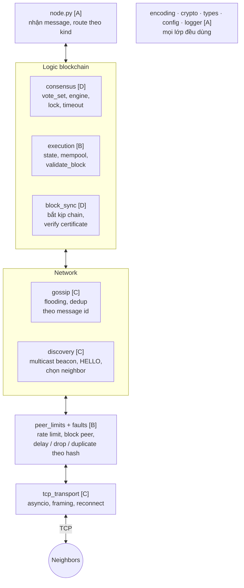
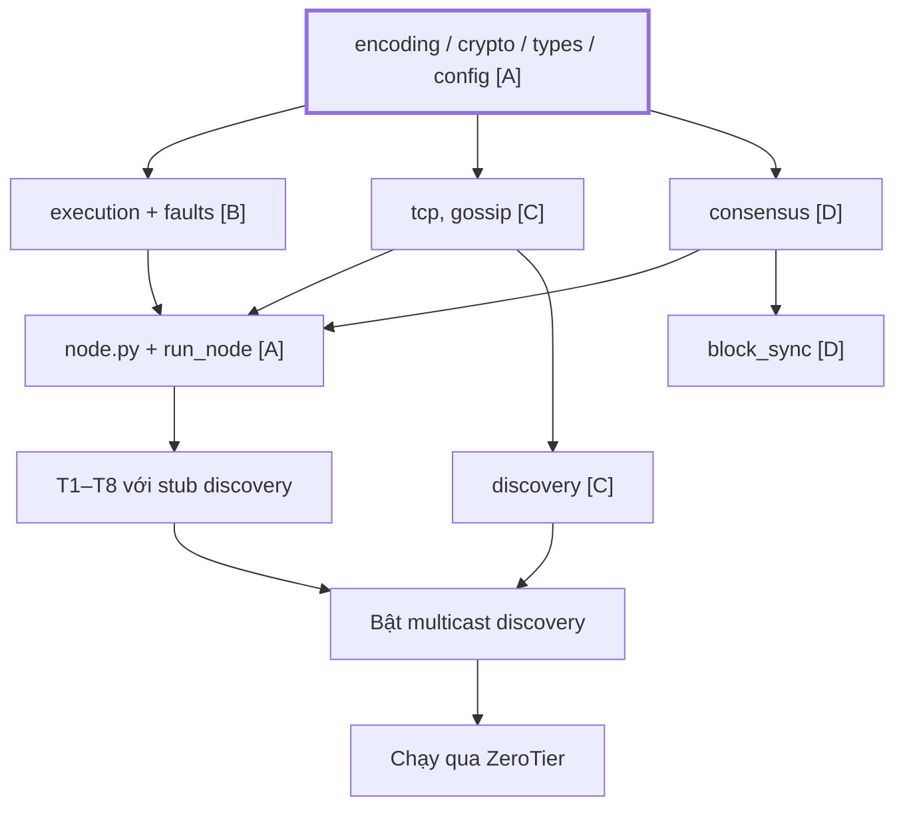
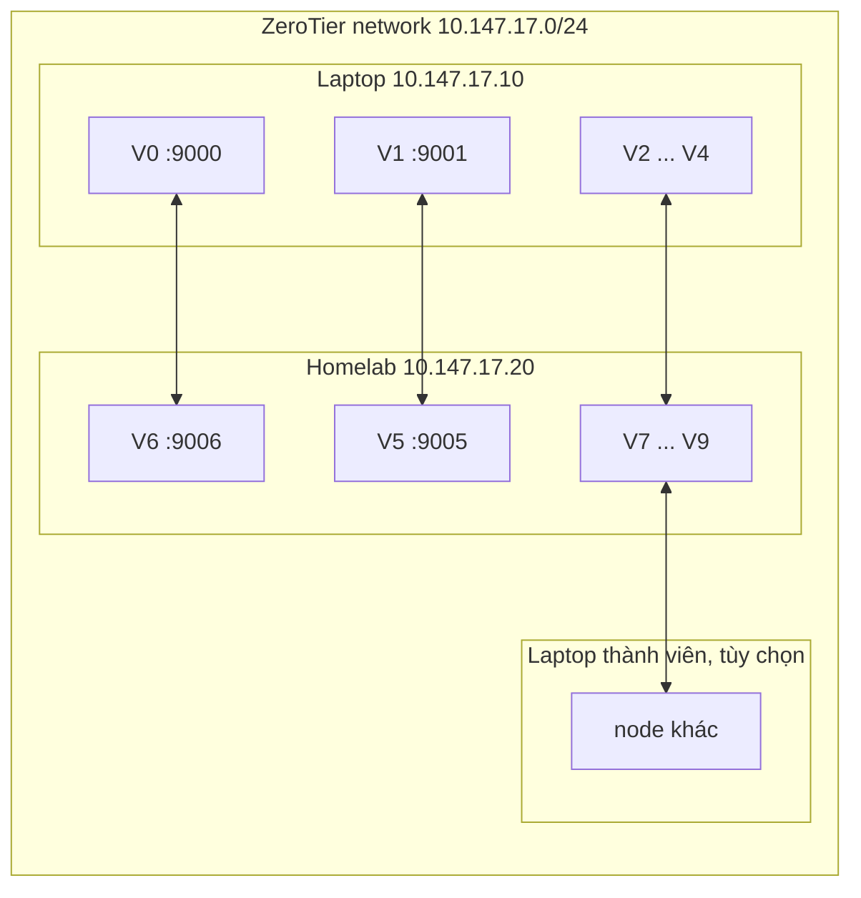
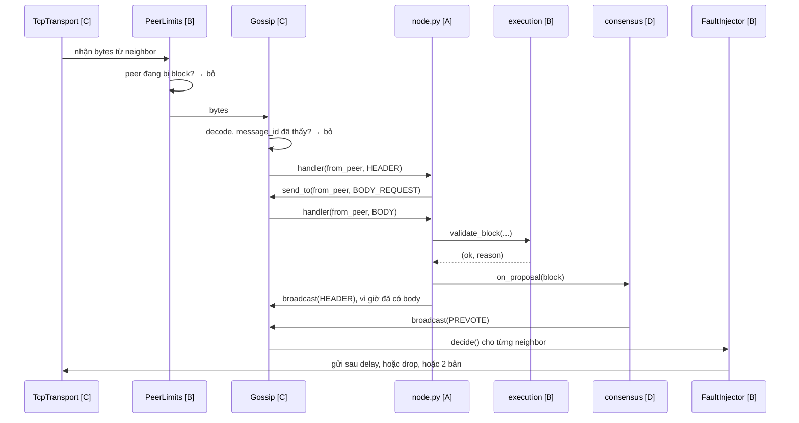
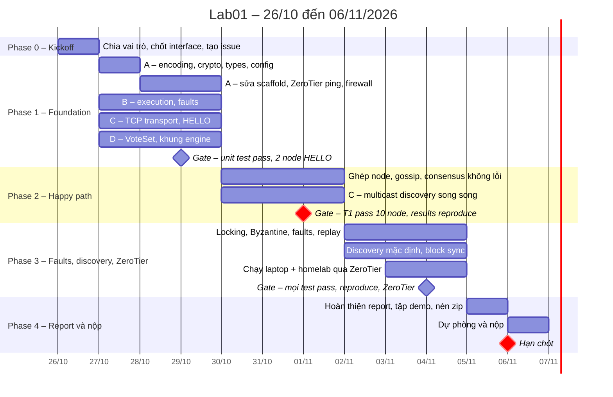
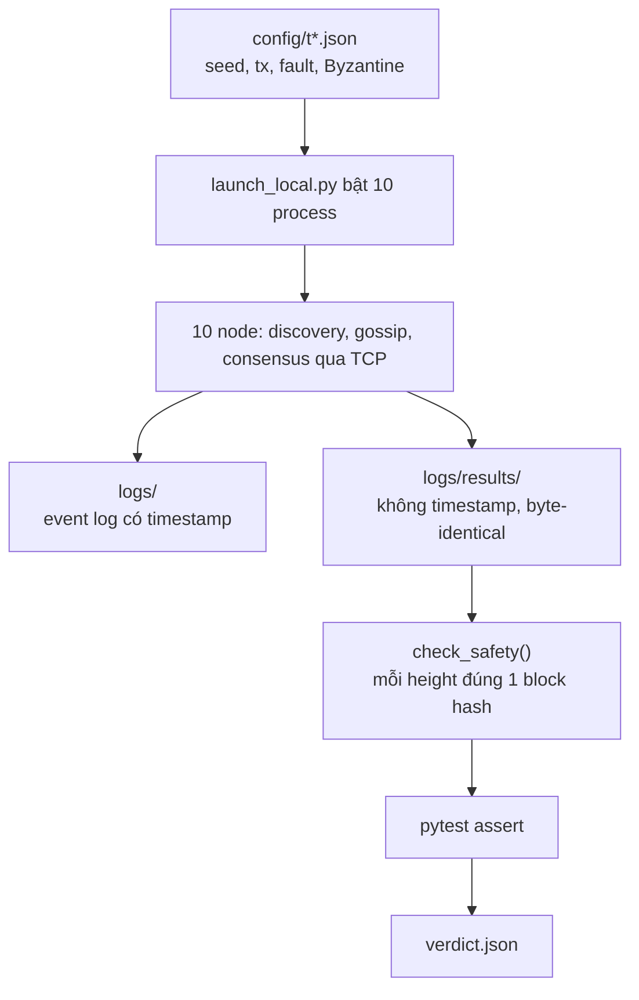

# Lab01 – Team Plan

> Kế hoạch làm Lab01 cho nhóm 4 người. Hạn nộp **06/11/2026**, nhóm nhắm nộp tối **05/11**. Ai chưa rõ thuật ngữ: đọc [`CONCEPT_GUIDE.md`](./CONCEPT_GUIDE.md) trước, tối thiểu Tầng 1–4. Quy trình branch, commit, PR: xem [`CONTRIBUTING.md`](../CONTRIBUTING.md).

## Mục lục

1. [Mục tiêu & definition of done](#mục-tiêu--definition-of-done)
2. [Kiến trúc & cấu trúc thư mục](#kiến-trúc--cấu-trúc-thư-mục)
3. [Chạy nhiều máy qua ZeroTier](#chạy-nhiều-máy-qua-zerotier)
4. [Peer discovery](#peer-discovery)
5. [Reproducibility: thiết kế cho T8](#reproducibility-thiết-kế-cho-t8)
6. [Interfaces giữa các module](#interfaces-giữa-các-module)
7. [Phân công](#phân-công)
8. [Timeline](#timeline)
9. [Testing plan](#testing-plan)
10. [Quy ước code](#quy-ước-code)
11. [Report, design rationale, vấn đáp & submission](#report-design-rationale-vấn-đáp--submission)
12. [Rủi ro & quyết định đã chốt](#rủi-ro--quyết-định-đã-chốt)

---

## Mục tiêu & definition of done

Xây một blockchain Layer 1 mini bằng **Python** theo mô hình **peer-to-peer**: mỗi node là một process riêng chạy trong một terminal, tự tìm các node khác bằng **peer discovery**, chỉ giữ TCP connection với một số **neighbor**, và chuyển message tới mọi node bằng **gossip**. Chạy được trên một máy, và trên nhiều máy qua **ZeroTier**. Consensus theo kiểu **Tendermint**: Propose → Prevote → Precommit, có locking. Mọi honest node phải finalize cùng chuỗi block dù network bị delay, drop, duplicate và có tới f node Byzantine.

Giảng viên chấm theo tiêu chí: cách chỉ vừa đáp ứng yêu cầu sẽ không được đánh giá cao; muốn điểm cao nhất phải **lập luận được rằng cách mình chọn là hợp lý nhất**. Vì vậy mỗi quyết định thiết kế đều phải được ghi lại cùng lý do, xem mục Design rationale.

**Coi là xong khi:**

- [ ] `python -m l1sim.run_node --id V3 --port 9003 --scenario config/t1_normal.json` chạy được một node trong một terminal, tự tìm peer, không cần ghi sẵn địa chỉ của node khác.
- [ ] 10 terminal, 10 node trên một máy, mọi node finalize cùng chuỗi block.
- [ ] Node chia trên laptop và homelab qua ZeroTier, mọi node finalize cùng chuỗi block, và `logs/results/` giống hệt khi chạy trên một máy.
- [ ] `make test` chạy toàn bộ unit test và T1–T8, D1–D3, tất cả pass.
- [ ] `python tests/check_reproducible.py` chạy mọi scenario 2 lần, `logs/results/` giữa 2 lần **byte-identical**, và trùng với bản nhóm nộp.
- [ ] README.md hướng dẫn cài đặt, chạy từng node bằng terminal, chạy nhiều máy, chạy test, cách giảng viên reproduce kết quả.
- [ ] REPORT.pdf viết bằng tiếng Việt, tối đa 10 trang, đủ các mục đề yêu cầu, không chèn source code.
- [ ] Nộp đúng tên `Lab01_ID1_ID2_ID3_ID4.zip` với `src/ tests/ logs/ config/ README.md REPORT.pdf`.

**Ngoài phạm vi:** gas, fees, smart contract, RPC/API cho client, light client, lưu dữ liệu xuống disk, TLS, NAT traversal tự viết. Kết nối giữa các máy ở xa do ZeroTier lo.

---

## Kiến trúc & cấu trúc thư mục

Mỗi node là một process Python dùng `asyncio`. Một process xử lý được nhiều TCP connection cùng lúc mà không cần tự quản lý thread. Chạy song song thật đến từ việc có nhiều process.

Các lớp bên trong một node:



*Chữ trong ngoặc vuông là người phụ trách. Message gửi đi đi từ trên xuống, message nhận được đi từ dưới lên; consensus và execution gọi lẫn nhau trong lớp "Logic blockchain".*

### Quyết định kỹ thuật đã chốt

| Hạng mục | Chọn | Lý do ngắn, chi tiết ở mục Design rationale |
| --- | --- | --- |
| Ngôn ngữ | Python ≥ 3.10, CI dùng 3.12 | Giảng viên khuyên không dùng C/C++; asyncio, dataclass tốt |
| Package | `l1sim`, đã có trong repo | Giữ nguyên scaffold |
| Kết nối | TCP bằng `asyncio` | Nhiều connection trong 1 process, không cần tự quản lý thread |
| Chạy | Mỗi node 1 process, 1 terminal, port riêng | Giảng viên xác nhận; song song thật ở mức process |
| Nhiều máy | ZeroTier, bind `0.0.0.0`, quảng bá IP ZeroTier | LAN ảo giữa laptop và homelab, hỗ trợ multicast |
| Framing | 4 bytes độ dài big-endian + bytes từ `encode()` | Đơn giản, dễ debug |
| Tìm peer | Chỉ multicast beacon có chữ ký, không có bootstrap | Không cần ghi sẵn địa chỉ, không có node nào là điểm chết chung, ít loại message hơn |
| Chọn neighbor | Xếp hạng peer bằng `sha256(seed, self_id, peer_id)`, giữ top `target_degree` | Deterministic, phân bố đều, reproduce được |
| Xác thực peer | `HELLO` và `ANNOUNCE` có chữ ký, domain `HELLO:lab01`; public key tra trong genesis | Byzantine không mạo danh được validator khác |
| Truyền tin | Gossip flooding, dedup theo `sha256` của message | Node chỉ nối tới neighbor |
| Network không ổn định | Fault injection tính theo hash của message, GST tính theo **height**, delay hai cực | Bắt buộc cho T2, T5, và reproduce được |
| Bắt kịp chain | Block sync kèm commit certificate | Node restart hoặc vào trễ vẫn tham gia lại được |
| Signature | Ed25519, thư viện `cryptography` | Chữ ký deterministic, nhanh |
| Hash | SHA-256, `hashlib` | Có sẵn |
| Encoding | Canonical JSON: `sort_keys=True`, `separators=(",",":")`, bytes → hex | Dễ debug, dễ đọc log |
| State commitment | `sha256(encode(sorted state))` | Đủ cho lab, không cần Merkle tree |
| Số node mặc định | 10 validator: n = 10, f = 3, quorum = 7; `target_degree` = 4 | n = 3f + 1 và ≥ 8 node; ≥ f + 1 neighbor để Byzantine node khó cô lập một node |
| Proposer | `validators[(height + round) % n]` | Deterministic, node nào cũng tự tính được |
| Validator set | Cố định trong `config/genesis.json` | Đề yêu cầu validator set cố định trong một lần chạy |
| Lint, format | `ruff`, đã cấu hình trong `pyproject.toml` | Giữ nguyên scaffold, CI đã chạy |
| Test | `pytest`, gọi qua `make test` | Giữ nguyên scaffold |
| chain_id | `"lab01"` | Dùng trong domain tag |

### Cấu trúc thư mục

Cột phải là người phụ trách. File có sẵn trong repo đánh dấu `có sẵn`.

```
blockchain-lab01/
├── src/l1sim/
│   ├── __init__.py          # có sẵn
│   ├── encoding.py          # encode, decode, sha256_hex, message_id    [A]
│   ├── crypto.py            # keygen từ seed, sign/verify có domain      [A]
│   ├── types.py             # Tx, BlockHeader, Block, Vote, Message      [A]
│   ├── config.py            # đọc genesis + scenario JSON               [A]
│   ├── logger.py            # event log + results writer                [A]
│   ├── node.py              # ghép mọi thứ, route message               [A]
│   ├── run_node.py          # chạy 1 node trong 1 terminal              [A]
│   ├── client.py            # gửi tx của scenario vào mạng              [A]
│   ├── launch_local.py      # bật N process cho test tự động            [B]
│   ├── execution/
│   │   ├── state.py         # State, apply_tx, apply_block, state_hash   [B]
│   │   ├── mempool.py       # hàng chờ tx, chống trùng                   [B]
│   │   └── validation.py    # validate_tx, validate_block (rule 3)       [B]
│   ├── consensus/
│   │   ├── vote_set.py      # đếm vote, dedup, phát hiện equivocation    [D]
│   │   ├── engine.py        # Tendermint state machine, lock, timeout    [D]
│   │   ├── byzantine.py     # hành vi xấu: silent, equivocate, replay    [D]
│   │   └── block_sync.py    # GET_BLOCKS, verify commit certificate      [D]
│   └── network/
│       ├── tcp_transport.py # asyncio server/client, framing, reconnect  [C]
│       ├── discovery.py     # multicast beacon, HELLO, chọn neighbor        [C]
│       ├── gossip.py        # flooding + dedup theo message id           [C]
│       ├── faults.py        # fault injection theo hash, gst_height      [B]
│       └── peer_limits.py   # rate limit, block/unblock peer             [B]
├── tests/
│   ├── run_tests.py         # entry point cho người chấm, không cần make [A]
│   ├── check_safety.py      # đọc results mọi node, so block hash       [B]
│   ├── check_reproducible.py# chạy 2 lần, so logs/results/              [B]
│   ├── requirements.txt     # version cố định, cho người chấm            [A]
│   ├── unit/                # có sẵn, có test_smoke.py
│   └── e2e/                 # có sẵn, trống: T1–T8, D1–D3
├── config/
│   ├── default.json         # có sẵn, sửa lại theo genesis + scenario    [A]
│   ├── genesis.json         # chain_id, seed, validator ids + public keys [A]
│   ├── zerotier.example.json# mẫu chạy nhiều máy                        [A]
│   └── t1_normal.json ...   # scenario: tx, fault, Byzantine, discovery
├── logs/                    # event log có timestamp, mỗi node 1 file
│   └── results/             # kết quả không timestamp, phải byte-identical
├── scripts/                 # có sẵn; chỉ dùng khi phát triển, không nộp
│   ├── check_determinism.sh # có sẵn, chuyển thành gọi tests/check_reproducible.py
│   ├── mcast_test.py        # kiểm tra multicast + đo round-trip qua ZeroTier [A]
│   ├── collect_logs.sh      # gom logs từ homelab về laptop qua ZeroTier [A]
│   └── package.sh           # tạo Lab01_ID1_ID2_ID3_ID4.zip đúng 6 mục  [A]
├── docs/                    # CONCEPT_GUIDE.md, TEAM_PLAN.md, DESIGN.md
├── Makefile, pyproject.toml, CONTRIBUTING.md, .github/   # có sẵn
├── README.md                # có sẵn, cần sửa
└── REPORT.pdf
```

**Vì sao có `tests/run_tests.py` dù đã có `make test`:** file zip nộp chỉ gồm 6 mục, không có `Makefile` và `pyproject.toml`. Người chấm cần một cách chạy không phụ thuộc 2 file đó: `pip install -r tests/requirements.txt` rồi `python tests/run_tests.py`. File này tự thêm `src/` vào `sys.path` rồi gọi pytest. Khi phát triển thì cứ dùng `make test`.

Thứ tự phụ thuộc giữa các module:



*`encoding / crypto / types` là nút cổ chai: A phải xong trước tối 27/10. Trong lúc chờ, những người khác dùng stub. Discovery được C làm song song; trước khi xong, A dùng một stub `Discovery` trả về `127.0.0.1:9000 + index` cho cả 10 node. Stub này chỉ để ghép code, không nằm trong bản nộp.*

### Việc phải sửa trong scaffold hiện có

| File | Hiện tại | Sửa thành |
| --- | --- | --- |
| `README.md` | "simulated unreliable network", 5 dòng ID, lệnh `python -m l1sim.run` | P2P qua TCP + fault injection, 4 ID, lệnh `run_node` |
| `config/default.json` | `num_validators: 8`, `gst_ms`, `chain_id: lab01-devnet` | 10 validator, `gst_height`, `chain_id: lab01`, thêm phần discovery |
| `.gitignore` | Bỏ qua toàn bộ `logs/*` | Vẫn bỏ qua khi dev; commit `logs/` và `logs/results/` của lần chạy chính thức bằng `git add -f` |
| `scripts/check_determinism.sh` | Gọi `l1sim.run` chưa tồn tại, so `diff -r` toàn bộ log | Gọi `tests/check_reproducible.py`, chỉ so `logs/results/` |
| `Makefile` | Target `determinism` | Trỏ tới `check_reproducible.py`; thêm target `package` |
| `.github/CODEOWNERS` | Chỉ có 1 owner | Thêm owner theo vai trò A/B/C/D sau kickoff |

---

## Chạy nhiều máy qua ZeroTier

Thầy chỉ yêu cầu chạy trên một máy. Chạy thêm trên nhiều máy qua ZeroTier là **điểm cộng**: chứng minh code là P2P thật, và cho thấy `logs/results/` không đổi khi chuyển từ 1 máy sang 2 máy.

**ZeroTier làm gì:** tạo một LAN ảo giữa laptop và homelab dù ở 2 nơi khác nhau. Mỗi máy có một IP ZeroTier, ví dụ `10.147.17.10` và `10.147.17.20`, và gọi nhau như đang chung một switch. Vì là LAN ảo nên **multicast chạy được**, đó là thứ multicast discovery cần.



**Cấu hình node khi chạy nhiều máy:**

- `--listen 0.0.0.0:9005`: nhận connection trên mọi interface.
- `--advertise 10.147.17.20:9005`: địa chỉ node quảng bá cho người khác, phải là **IP ZeroTier**, không phải IP Wi-Fi hay `127.0.0.1`.
- `--mcast-iface 10.147.17.20`: gửi multicast qua interface ZeroTier. Nếu thiếu, hệ điều hành gửi qua interface mặc định, ví dụ interface của 5G hotspot, và máy kia không nhận được.

**Checklist trước khi chạy nhiều máy:**

- [ ] Network ZeroTier bật **Enable Broadcast** trong trang quản trị; kiểm tra multicast limit đủ cho số node.
- [ ] `ping` giữa các máy qua IP ZeroTier thành công. `zerotier-cli peers` cho biết đường nối là `DIRECT` hay `RELAY`; `RELAY` chậm hơn nhiều. Mạng 5G thường đặt máy sau CGNAT, nên khi laptop dùng 5G hotspot, đường nối tới homelab dễ thành `RELAY`; phải đo lại độ trễ khi đang dùng đúng 5G hotspot.
- [ ] Đo round-trip bằng `mcast_test.py --iface <IP ZeroTier>` trên cả 2 máy; timeout của consensus phải ≥ 10 lần round-trip tệ nhất, để giữ được "delay hai cực", xem mục Reproducibility.
- [ ] Firewall trên cả 2 máy mở dải TCP port của node và UDP port của multicast discovery trên interface ZeroTier.
- [ ] Code giống hệt nhau trên các máy: cùng commit, cùng `config/`.
- [ ] Sau khi chạy, `scripts/collect_logs.sh` gom `logs/` từ homelab về laptop để chạy `check_safety.py` và so results.

### Kết quả đo ngày 27/10 và timing profile

Đo bằng `mcast_test.py`, 60 giây, homelab cắm router nhà, laptop dùng 5G hotspot, cả hai dùng `--iface` với IP ZeroTier; `--zerotier` không dùng được vì `zerotier-cli` cần quyền root.

| Hướng | Round-trip min / avg / max | Beacon nhận được |
| --- | --- | --- |
| homelab → laptop | 26,7 / 80,3 / 289,1 ms | 53 / 56 |
| laptop → homelab | 25,3 / 86,8 / 336,5 ms | 52 / 56 |

- **Multicast qua ZeroTier chạy được.** Khoảng 6% beacon bị mất, chấp nhận được vì beacon phát lại mỗi giây; message của consensus đi bằng TCP nên không bị ảnh hưởng.
- **min ~25 ms** cho thấy đường nối gần như DIRECT; **max ~340 ms** là jitter của 5G và là con số dùng để chọn timeout.
- Một chiều tệ nhất ~170 ms; gossip tới đủ node qua tối đa ~3 chặng, trong đó ≤ 2 chặng qua ZeroTier → ~0,5 s. Timeout lấy khoảng 6 lần con số đó.

Scenario có tham số `timing_profile`. Mọi delay của fault injection tính **theo tỉ lệ của timeout**, nên 2 profile phải cho ra `logs/results/` giống hệt nhau:

| Tham số | `local`, 1 máy | `zerotier`, nhiều máy |
| --- | --- | --- |
| Timeout propose / prevote / precommit, round 0 | 1000 ms | 3000 ms |
| Tăng thêm mỗi round | +300 ms | +1000 ms |
| Delay ngắn của fault injection | ≤ 2% timeout = 20 ms | ≤ 2% timeout = 60 ms |
| Delay dài của fault injection | 2,5 × timeout = 2500 ms | 2,5 × timeout = 7500 ms |

- Test tự động dùng `local` cho nhanh. Chạy cùng scenario với `zerotier` rồi so results với bản `local` là thêm một bằng chứng reproducibility khi vấn đáp.
- Trước vấn đáp, đo lại tại phòng thi bằng 5G. Round-trip tệ nhất vượt ~500 ms → tăng timeout `zerotier` lên 5000 ms.

**Lưu ý về thời gian:** đồng hồ của laptop và homelab có thể lệch nhau. Không có quyết định nào trong code dựa vào việc so đồng hồ giữa 2 máy: GST tính theo height, timeout chỉ đo khoảng thời gian trên đồng hồ của chính node đó. Timestamp trong event log sẽ lệch giữa 2 máy, và chỉ dùng để đọc.

---

## Peer discovery

**Mục tiêu:** node mới bật lên tự tìm được các node khác, tự chọn neighbor, và tự thay neighbor khi neighbor chết. Chi tiết khái niệm: Concept Guide, Tầng 3, mục Peer discovery.

**Tách 2 câu hỏi:**

- **"Ai được tham gia?"** do `genesis.json` quyết định: danh sách validator id và public key, cố định suốt lần chạy. Discovery **không** thêm validator mới.
- **"Validator đó đang ở địa chỉ nào?"** do discovery tìm ra lúc chạy.

**Cách tìm peer: chỉ dùng multicast beacon.** Mỗi node định kỳ gửi UDP `ANNOUNCE {node_id, advertise_addr, chain_id}` có chữ ký tới nhóm multicast, ví dụ `239.1.1.1`. Node khác nghe, verify chữ ký bằng public key trong genesis, rồi thêm vào address book. Chạy được trên localhost và trên ZeroTier.

**Vì sao không cần bootstrap:** validator set đã cố định trong genesis, và mọi node luôn nằm trong cùng một LAN: localhost, hoặc LAN ảo ZeroTier. Trong điều kiện đó multicast là cách đơn giản nhất: không cần ghi sẵn địa chỉ, không có node bootstrap nào là điểm chết chung, không cần thêm message `GET_PEERS`/`PEERS`. Khi demo, laptop dùng 5G hotspot thay vì Wi-Fi của trường, nên không lo mạng chặn multicast.

**Các bước:**

1. **Nghe beacon:** gom địa chỉ vào address book. Vì genesis cho biết có đúng n validator, node biết khi nào đã nghe đủ.
2. **HELLO handshake:** mở TCP, hai bên gửi `HELLO {node_id, advertise_addr, chain_id, finalized_height}` có chữ ký. Sai chữ ký, sai chain_id, hoặc id không có trong genesis → đóng connection, log `reason`.
3. **Chọn neighbor:** khi đã nghe đủ n − 1 peer hoặc hết `warmup`, xếp hạng mọi peer đã biết theo `sha256(seed | self_id | peer_id)`, kết nối tới `target_degree` peer đứng đầu; nhận thêm inbound tới `max_degree`.
4. **Bảo trì:** neighbor mất kết nối quá `peer_timeout` → bỏ, log `peer_removed`, kết nối tới peer xếp hạng tiếp theo, log `peer_added`.
5. **Bắt kịp:** nếu `finalized_height` của neighbor cao hơn của mình → chạy block sync trước khi tham gia consensus.
6. Consensus chỉ bắt đầu height 1 khi node đã đủ `target_degree` neighbor và hết `warmup` của scenario.

**Multicast chỉ dùng để tìm peer.** Vote, block, tx luôn đi bằng TCP tới neighbor + gossip. Nếu gửi vote bằng multicast thì không còn neighbor hay gossip, tức là không còn P2P, và UDP còn mất gói, không có thứ tự.

**Block sync:** node restart hoặc vào trễ gửi `GET_BLOCKS from_height`; neighbor trả về các block kèm **commit certificate** là 2f + 1 PRECOMMIT có chữ ký, nên node tự verify được mà không cần tin neighbor. Khái niệm: Concept Guide, Tầng 3, mục Block sync. Không có phần này thì node restart sẽ kẹt mãi ở height cũ.

---

## Reproducibility: thiết kế cho T8

**Thầy giải thích:** mục tiêu của byte-identical là khi thầy chạy lại thì ra **đúng kết quả nhóm đã nộp**. Timestamp và thứ tự event được phép khác nhau; ngoài timestamp, hiếm khi không thể làm scenario byte-identical. Khái niệm chi tiết: Concept Guide, Tầng 5.

| Output | Nằm ở | Có timestamp | Yêu cầu |
| --- | --- | --- | --- |
| Event log | `logs/<scenario>/<node>.jsonl` | Có | Để debug, làm bằng chứng; được phép khác nhau |
| Results | `logs/results/<scenario>/<node>.json` + `verdict.json` | Không | **Byte-identical** giữa mọi lần chạy, trên mọi máy |

**Results của mỗi node:** finalized chain với `height, round, proposer, block_hash, state_hash, tx ids`; final state hash; số lần reject theo từng reason; danh sách equivocation phát hiện được; neighbor set. `verdict.json` ghi pass/fail của từng assert trong test.

| Nguồn khác biệt | Cách loại bỏ |
| --- | --- |
| Key sinh ngẫu nhiên | `keypair_from_seed(seed, node_id)` |
| Tx tới mempool lúc nào | `client.py` gửi toàn bộ tx của scenario trong lúc `warmup`; mempool lấy tx theo `(sender, nonce)`, tối đa `max_txs_per_block` |
| Topology | Chọn neighbor bằng hash của seed, không phụ thuộc thứ tự node bật lên |
| Message nào bị drop / duplicate / delay bao lâu | Hàm thuần của `sha256(seed, src, dst, message_id)`, **không** dùng rng tuần tự |
| Ranh giới GST | Theo **height**: lỗi nặng khi `height < gst_height` |
| Message vừa kịp hay vừa trễ timeout | **Delay hai cực**: ≤ 10% timeout hoặc ≥ 2× timeout, không có gì ở giữa |
| Độ trễ thật của ZeroTier | Timing profile `zerotier`, chọn từ số đo ngày 27/10, xem mục Chạy nhiều máy |
| Byzantine làm gì | Ghi rõ trong scenario: node nào, height nào, làm gì |
| Thứ tự duyệt `set` / `dict` | `sorted(...)` |
| `hash()` của Python, `id(obj)` | Không dùng cho results, chain hay network |
| Phiên bản thư viện | `tests/requirements.txt` ghi version cố định |

`tests/check_reproducible.py` chạy **mọi** scenario 2 lần, so `sha256` của từng file trong `logs/results/`, in ra file nào khác. Option `--compare logs/results/` để người chấm so với bản nhóm nộp.

---

## Interfaces giữa các module

Đây là "hợp đồng" để 4 người code song song. **Chốt trong buổi kickoff; muốn đổi sau đó phải báo cả nhóm và cập nhật file này.** Module người khác chưa xong thì viết stub theo đúng signature.

### types.py (A viết đầu tiên, mọi người dùng)

```python
@dataclass(frozen=True)
class Tx:
    sender: str          # tên participant, vd "Alice"; public key tra trong genesis
    key: str             # phải bắt đầu bằng f"{sender}/"
    value: str
    nonce: int
    signature: str = ""  # hex, ký với domain TX:lab01

@dataclass(frozen=True)
class BlockHeader:
    height: int
    round: int
    parent_hash: str
    tx_root: str         # hash của danh sách tx
    state_hash: str      # hash state SAU khi apply
    proposer: str        # validator id
    signature: str = ""  # domain HEADER:lab01

@dataclass(frozen=True)
class Block:
    header: BlockHeader
    txs: tuple[Tx, ...]

@dataclass(frozen=True)
class Vote:
    phase: str           # "PREVOTE" | "PRECOMMIT"
    height: int
    round: int
    block_hash: str | None   # None = NIL
    voter: str
    signature: str = ""  # domain VOTE:lab01

@dataclass(frozen=True)
class CommitCertificate:
    height: int
    block_hash: str
    precommits: tuple[Vote, ...]   # ≥ 2f + 1 PRECOMMIT cho block_hash

@dataclass(frozen=True)
class Message:
    kind: str            # TX | HEADER | BODY_REQUEST | BODY | VOTE
                         # HELLO | GET_BLOCKS | BLOCKS
    origin: str          # node tạo ra message, không đổi khi được chuyển tiếp
    height: int          # dùng cho fault injection theo gst_height; 0 nếu không thuộc height nào
    payload: object
```

`ANNOUNCE` của multicast discovery không đi qua TCP nên không phải `Message`; nó là một gói UDP riêng `{node_id, advertise_addr, chain_id, signature}`.

### encoding.py & crypto.py (A)

```python
def encode(obj) -> bytes            # canonical JSON; MỌI hash, sign, network, results đều dùng hàm này
def decode(data: bytes) -> Message
def sha256_hex(data: bytes) -> str
def message_id(msg) -> str          # sha256_hex(encode(msg)), dùng cho gossip dedup và fault injection
def block_hash(header) -> str       # hash header KHÔNG gồm signature

def keypair_from_seed(seed: int, name: str) -> KeyPair
def sign(sk, domain: str, obj) -> str           # domain: "TX" | "HEADER" | "VOTE" | "HELLO"
def verify(pk, domain: str, obj, sig: str) -> bool
```

### execution (B)

```python
class State:
    def copy(self) -> "State"
    def state_hash(self) -> str

def validate_tx(state, tx) -> tuple[bool, str]       # (ok, reason)
def apply_block(state, txs) -> State                  # trả về state mới, không sửa state cũ
def validate_block(block, parent_hash, state, expected_proposer, validator_keys) -> tuple[bool, str]

class Mempool:
    def add(self, tx) -> bool
    def take(self, state, max_n: int) -> list[Tx]      # tx hợp lệ, sắp xếp theo (sender, nonce)
    def remove_committed(self, txs) -> None
```

### faults.py & peer_limits.py (B)

```python
class FaultInjector:                 # nằm ngay trước TcpTransport.send
    def __init__(self, seed, fault_cfg, logger)
    def decide(self, src, dst, msg) -> list[int]
        # hàm thuần của sha256(seed, src, dst, message_id(msg)) và msg.height
        # trả về delay_ms cho từng bản sẽ gửi: [] = drop, [d] = 1 bản, [d1, d2] = duplicate
        # mọi delay nằm ở 2 cực: ≤ 10% timeout hoặc ≥ 2× timeout

class PeerLimits:
    def allow_send(self, peer_id) -> bool
    def on_receive(self, peer_id) -> bool  # False = peer đang bị block, bỏ message
```

### network (C)

```python
class TcpTransport:
    def __init__(self, node_id, listen_addr, logger)
    async def start(self) -> None
    async def connect(self, addr: str) -> str | None      # trả node_id sau HELLO, None nếu thất bại
    async def send(self, peer_id: str, data: bytes) -> None
    def close(self, peer_id: str) -> None
    def set_receiver(self, callback) -> None              # callback(from_peer_id, data)
    def set_disconnect_handler(self, callback) -> None    # callback(peer_id)

class Discovery:
    def __init__(self, node_id, genesis, scenario, transport, keypair, logger)
    async def start(self) -> None          # multicast beacon, HELLO, chọn neighbor
    def neighbors(self) -> list[str]       # sorted
    def ready(self) -> bool                # đủ target_degree neighbor
    def peer_heights(self) -> dict[str, int]   # finalized_height từ HELLO, dùng cho block sync

class Gossip:
    def __init__(self, node_id, discovery, sender, logger)
    def broadcast(self, msg: Message) -> None               # gửi tới mọi neighbor
    def send_to(self, peer_id: str, msg: Message) -> None   # chỉ 1 neighbor: BODY_REQUEST, BODY, GET_BLOCKS, BLOCKS
    def set_handler(self, callback) -> None
    # nhận message: message_id đã thấy → bỏ; chưa thấy → gọi handler, rồi chuyển tiếp cho mọi neighbor trừ người gửi
    # riêng message gửi bằng send_to không được chuyển tiếp
```

### consensus (D)

```python
class VoteSet:
    def add(self, vote) -> str   # "added" | "duplicate" | "equivocation" | "invalid"
    def count(self, h, r, phase, block_hash) -> int
    def has_quorum(self, h, r, phase) -> str | None  # block_hash đạt quorum, hoặc None
    def certificate(self, h, r, block_hash) -> CommitCertificate

class ConsensusEngine:
    # state: height, round, step, locked_block, locked_round, signed_votes
    def start_round(self, round: int) -> None
    def on_proposal(self, block) -> None
    def on_vote(self, vote) -> None
    def on_timeout(self, height, round, step) -> None   # hẹn bằng loop.call_later

def verify_certificate(cert, block, validator_keys, quorum) -> tuple[bool, str]

class BlockSync:
    async def catch_up(self, from_height: int, peer_id: str) -> int   # trả height mới sau khi bắt kịp
    def on_get_blocks(self, peer_id, from_height) -> None             # trả lời neighbor xin block
```

### node.py (A ghép)

`Node(node_id, listen_addr, advertise_addr, genesis, scenario, logger)` dựng TcpTransport, Discovery, FaultInjector, PeerLimits, Gossip, VoteSet, ConsensusEngine, BlockSync, State, Mempool. Message từ Gossip được route: `TX` → mempool, `HEADER`/`BODY` → kiểm tra rồi đưa vào engine, `VOTE` → verify signature rồi đưa vào engine, `GET_BLOCKS`/`BLOCKS` → BlockSync. Node lưu commit certificate của mọi block đã finalize. Khi scenario kết thúc, node ghi `logs/results/<scenario>/<node>.json` bằng `encode()`.

Một message đi qua các lớp:



---

## Phân công

Mỗi người **sở hữu một phần**: code, unit test và đoạn report của phần đó, cộng vài test end-to-end. Vai trò A/B/C/D **chưa gán người**, chốt trong kickoff. Vì A là người hiểu tổng thể và giữ máy homelab, A nên là trưởng nhóm.

| Người | Vai trò | Module | Unit test | E2E test | Viết report |
| --- | --- | --- | --- | --- | --- |
| A, trưởng nhóm | Foundation + Integration + ZeroTier | `encoding`, `crypto`, `types`, `config`, `logger`, `node`, `run_node`, `client`, `tests/run_tests.py`, sửa scaffold, `scripts/` | sign/verify, sai domain bị reject, encode ổn định | T1, T3, chạy ZeroTier | Introduction, System Design, ghép report |
| B | Execution + Faults + Reproducibility | `state`, `mempool`, `validation`, `faults`, `peer_limits`, `launch_local`, `check_safety`, `check_reproducible` | apply tx, ownership, nonce, state_hash, fault decision theo hash, rate limit | T4, T5, T8 | Execution, fault injection, reproducibility, testing & results |
| C | P2P Network | `tcp_transport`, `discovery`, `gossip` | framing, HELLO, ANNOUNCE giả bị từ chối, chọn neighbor, gossip không lặp vô hạn | T2, D1, D2 | Network, discovery, gossip strategy |
| D | Consensus + Block sync | `vote_set`, `engine`, `byzantine`, `block_sync` | đếm vote, dedup, equivocation, lock rule, certificate thiếu chữ ký bị từ chối | T6, T7, D3 | Consensus, locking, vote rules, block sync |

**Quy tắc phối hợp:**

- Ai cũng đọc Concept Guide Tầng 1–4. D đọc kỹ phần Locking và Block sync, C đọc kỹ Tầng 3, B đọc kỹ Tầng 5.
- Mỗi việc là một GitHub issue, dùng template `task.yml` có sẵn; branch đặt tên theo `CONTRIBUTING.md`, ví dụ `feat/12-vote-counting`.
- Module người khác chưa xong → dùng stub, không chờ.
- Bug khó, mất hơn 1 giờ, ghi vào `docs/BUGS.md`: triệu chứng, nguyên nhân, cách fix. Report bắt buộc có mục này.
- Mỗi quyết định thiết kế ghi vào `docs/DESIGN.md`: chọn gì, các cách khác, vì sao chọn.
- Họp ngắn mỗi 2 ngày: mỗi người nói đã xong gì, đang kẹt gì.

---

## Timeline

Repo đã có scaffold, chưa có code, chưa chia vai trò. Bắt đầu tối **26/10**, hạn nộp **06/11/2026**: còn 11 ngày. Plan nhắm nộp tối **05/11**, giữ 06/11 làm dự phòng.



*Gate 01/11 là mốc quyết định: 10 node trong 10 terminal finalize cùng chuỗi block, và chạy 2 lần ra `logs/results/` byte-identical. Qua được mốc này thì phần còn lại là thêm kịch bản lỗi, bật discovery, và chạy qua ZeroTier.*

### Phase 0 – Kickoff (tối 26/10)

- [ ] Cả nhóm: họp, gán người cho A/B/C/D, chốt mục Interfaces.
- [ ] A: thêm `docs/CONCEPT_GUIDE.md`, `docs/TEAM_PLAN.md`; tạo GitHub issue cho từng việc trong Phase 1–2; cập nhật `CODEOWNERS`.
- [ ] A: mời các thành viên join ZeroTier network nếu họ muốn tự test nhiều máy.
- [ ] Cả nhóm: ai chưa đọc Concept Guide Tầng 1–4 thì đọc trong 26–27/10.

### Phase 1 – Foundation (27–29/10)

- [ ] A: `encoding`, `crypto`, `types` xong **trước tối 27/10**; sau đó `config`, `logger`, `client`, `genesis.json`, scenario mẫu `t1_normal.json`.
- [ ] A: sửa scaffold theo bảng "Việc phải sửa"; kiểm tra ZeroTier giữa laptop và homelab: ping, firewall, đo độ trễ, cả khi laptop dùng 5G hotspot.
- [ ] C, ngày 28/10: viết script nhỏ thử multicast giữa 2 process trên **máy của cả 4 người** và giữa laptop với homelab qua ZeroTier. Vì không còn bootstrap, đây là việc phải chắc chắn sớm.
- [ ] B: `State`, `validate_tx`, `apply_block`, `Mempool`, `FaultInjector`, `PeerLimits` và unit test.
- [ ] C: `TcpTransport` với server, connect, framing, reconnect; HELLO handshake. Demo: 2 terminal, 2 node HELLO thành công.
- [ ] D: `VoteSet` và khung `ConsensusEngine` với `start_round`, `on_proposal`, `on_vote`, `on_timeout`.
- [ ] Gate 29/10: **unit test pass**, **2 node HELLO qua TCP**.

### Phase 2 – Happy path (30/10–01/11)

- [ ] A: `node.py`, `run_node.py`, ghép mọi module; dùng stub `Discovery` cho tới khi C xong.
- [ ] B: `launch_local.py`, `check_safety.py`, `check_reproducible.py`, results writer.
- [ ] C: `gossip.py`; message tới được mọi node trong 10 process. Song song: multicast beacon, HELLO, chọn neighbor.
- [ ] D: Propose → Prevote → Precommit → Finalize chạy được khi không có lỗi; lưu commit certificate.
- [ ] A + B: header-before-body qua gossip.
- [ ] Gate 01/11: **T1 pass với 10 node** và **`check_reproducible` pass trên T1**.

### Phase 3 – Faults, discovery, ZeroTier (02–04/11)

- [ ] D: locking theo rule 4–5, timeout tăng dần, `byzantine.py`; T6, T7. Sau đó `block_sync.py`, D3.
- [ ] B: scenario T5 theo `gst_height`; chống replay tx bằng nonce, T4; T8 trên mọi scenario.
- [ ] C: bật multicast discovery mặc định; T2, D1, D2.
- [ ] A: T3, `tests/run_tests.py`, `tests/requirements.txt`, README có phần reproduce cho giảng viên; chạy T1 và T7 qua ZeroTier vào 03–04/11, so results với lần chạy một máy.
- [ ] Cả nhóm: viết nháp phần report của mình **ngay khi module ổn định**, không đợi Phase 4.
- [ ] Gate 04/11: **mọi test pass**, **reproduce 2 lần byte-identical**, **chạy được qua ZeroTier**.

### Phase 4 – Report, demo & nộp (05–06/11)

- [ ] Mỗi người hoàn thiện phần report của mình, A ghép.
- [ ] Chạy lần chính thức, lưu `logs/` và `logs/results/`.
- [ ] Tập demo vấn đáp, xem mục Vấn đáp.
- [ ] `scripts/package.sh` tạo zip, chạy checklist nộp bài, nộp tối 05/11. Ngày 06/11 chỉ để sửa sự cố.

---

## Testing plan

Mọi test end-to-end đều chạy **process thật qua TCP trên localhost**: `launch_local.py` bật 10 process theo một scenario config, chờ đạt height mục tiêu hoặc hết thời gian, dừng các process, rồi pytest đọc `logs/results/`. Khi demo, cùng scenario đó chạy bằng tay trong 10 terminal, hoặc chia qua ZeroTier.



### End-to-end

| Test | Config | Cách tạo kịch bản | Assert | Owner |
| --- | --- | --- | --- | --- |
| T1 | `t1_normal.json` | Không fault, 10 node, ~20 tx, chạy tới height 5 | Mọi node cùng block hash ở từng height và cùng final state_hash | A |
| T2 | `t2_dup_reorder.json` | `dup_rate=0.3`, delay hai cực để message bị reorder | Không vote nào bị đếm 2 lần, results có số `duplicate_ignored`, không finalize xung đột | C |
| T3 | `t3_bad_sig.json` | Một node gửi tx/vote có signature sai, vote ký bằng domain TX, và HELLO/ANNOUNCE mạo danh id khác | Bị reject, results đếm đúng theo `bad_signature` / `wrong_domain` / `unknown_peer` | A |
| T4 | `t4_replay_tx.json` | Gửi lại cùng một tx nhiều lần ở nhiều height | Tx chỉ xuất hiện 1 lần trong chain, state đúng | B |
| T5 | `t5_pre_gst.json` | `drop_rate=0.4` khi `height < gst_height`, sau đó delay ≤ ∆ | Không bao giờ 2 hash khác nhau ở cùng height; sau `gst_height` chain tiếp tục | B |
| T6 | `t6_silent_proposer.json` | Proposer của height 2 round 0 im lặng | Height 2 finalize ở round 1 với proposer khác, chain tiếp tục | D |
| T7 | `t7_byzantine.json` | f = 3 node equivocate: vote 2 block, propose 2 block | Không finalize xung đột, results có danh sách equivocation | D |
| T8 | Mọi scenario, mỗi cái 2 lần | `check_reproducible.py` | `logs/results/` của 2 lần byte-identical | B |
| D1 | `d1_discovery.json` | Node bật theo thứ tự xáo trộn, không node nào biết trước địa chỉ của node khác | Mọi node đủ `target_degree` neighbor, graph connected, T1 vẫn pass | C |
| D2 | `d2_neighbor_dies.json` | Kill 1 neighbor của V0 sau height 2 | V0 log `peer_removed` rồi `peer_added`, chain tiếp tục | C |
| D3 | `d3_restart.json` | Kill V8 ở height 3, bật lại ở height 6 | V8 block sync tới height hiện tại, rồi finalize cùng chain với các node khác | D |

**Lưu ý D2, D3:** kill và bật lại theo **height** trong scenario, không theo thời gian, để results reproduce được.

### Unit test tối thiểu

- **crypto:** signature đúng verify được; sửa 1 field → fail; ký domain VOTE, verify domain TX → fail; vote height 5 không verify được ở height 6.
- **encoding:** 2 dict khác thứ tự key → cùng bytes; `decode(encode(msg)) == msg`.
- **tcp_transport:** 2 message gửi liền nhau → bên nhận tách đúng thành 2 message.
- **discovery:** HELLO hoặc ANNOUNCE sai chữ ký, id lạ bị từ chối; cùng seed và cùng peer set → cùng neighbor set dù thêm peer theo thứ tự khác; peer chết được thay bằng peer xếp hạng tiếp theo.
- **gossip:** cùng message nhận từ 2 neighbor → handler gọi 1 lần, chuyển tiếp 1 lần, không gửi ngược lại người gửi.
- **faults:** cùng (seed, src, dst, message) → cùng quyết định bất kể thứ tự gọi; không có delay nằm trong vùng cấm.
- **peer_limits:** vượt hạn mức → block; hết thời gian → unblock.
- **state:** Alice không sửa được `Bob/...`; nonce sai bị reject; cùng tx list → cùng state_hash.
- **vote_set:** cùng vote 2 lần → đếm 1; 2 vote khác nhau của cùng validator → `equivocation`; quorum đạt ở 2f + 1, không đạt ở 2f.
- **engine:** đã lock B thì không prevote C nếu chưa có polka mới hơn; không ký 2 prevote cho cùng (height, round).
- **block_sync:** certificate thiếu 1 chữ ký so với quorum, hoặc có chữ ký giả → từ chối block.
- **validation:** block sai parent, sai proposer, sai state_hash, hoặc có tx sai signature → reject kèm reason.

---

## Quy ước code

Quy trình branch, commit, PR đã có trong `CONTRIBUTING.md` và PR template; mọi người theo đúng file đó. Bổ sung riêng cho lab này:

- Mọi thứ đi vào hash, chữ ký, network hoặc `logs/results/` phải qua `encoding.encode()`. **Cấm** tự `json.dumps`.
- Không dùng `random.random()`, `hash()` của Python hay `id(obj)` cho logic. Random chỉ được dùng qua hash của seed như mục Reproducibility.
- Duyệt `set`/`dict` mà thứ tự ảnh hưởng kết quả → `sorted(...)` trước.
- `time` và `asyncio` được dùng cho timeout và network, nhưng không được quyết định điều gì đi vào results.
- Dataclass `frozen=True` cho mọi message và type, tránh sửa nhầm object đã ký.
- Hàm validate trả về `(ok, reason)`; reason là chuỗi cố định như `bad_signature`, `wrong_domain`, `bad_parent`, `not_owner`, `bad_nonce`, `unknown_peer`, `bad_certificate` để log, results và test dùng chung.
- Mỗi lần reject một thứ gì → **log kèm reason** và đếm vào results.
- Event log: JSON lines, mỗi node một file `logs/<scenario>/<node_id>.jsonl`; mỗi dòng có tối thiểu `time, node, event, height`.
- Network event cần log: `send`, `deliver`, `drop`, `delay`, `duplicate`, `block`, `unblock`, `peer_added`, `peer_removed`, `sync_start`, `sync_done`.
- Mọi tham số như số node, `target_degree`, timeout, fault rate, `gst_height`, Byzantine, kill/restart nằm trong scenario config, không hard-code, để sửa nhanh khi vấn đáp.
- Chạy `make lint test` trước khi push; CI đã kiểm tra `ruff` và pytest.

---

## Report, design rationale, vấn đáp & submission

REPORT.pdf tối đa 10 trang, **viết bằng tiếng Việt**, giữ nguyên thuật ngữ tiếng Anh như quorum, locking, domain separation, gossip, peer discovery. Mỗi người viết phần của mình, A ghép và sửa văn phong.

| Mục | Trang dự kiến | Người viết |
| --- | --- | --- |
| Thông tin thành viên + Project structure | 1 | A |
| Introduction: mục đích, các design choice chính | 1 | A |
| System Design: diagram module, discovery, message flow, chạy nhiều máy | 2 | A, C, D |
| Implementation Notes: guards, gossip strategy, fault injection, reproducibility, từng bước consensus, block sync | 3 | B, C, D |
| Non-trivial bugs & cách fix, lấy từ `docs/BUGS.md` | 1 | Cả nhóm |
| Testing and Results: T1–T8, D1–D3, kết quả ZeroTier, expected vs observed, anomalies | 1.5 | B, C |
| References | 0.5 | A |

### Design rationale

Thầy nói muốn điểm cao nhất phải lập luận được rằng cách chọn là hợp lý nhất. Mỗi quyết định lớn cần một đoạn trong report theo mẫu: **vấn đề → các cách có thể → cách nhóm chọn → vì sao các cách khác kém hơn**. Danh sách tối thiểu:

| Quyết định | Các cách khác cần so sánh |
| --- | --- |
| Gossip flooding với dedup | Broadcast trực tiếp tới mọi node; gossip ngẫu nhiên chọn vài neighbor |
| Chỉ multicast beacon | Danh sách peer cố định; bootstrap + peer exchange; DNS seed như Bitcoin |
| Multicast chỉ cho discovery, không cho consensus | Gửi vote bằng UDP multicast |
| Chọn neighbor bằng hash của seed | Chọn ngẫu nhiên; chọn theo ai trả lời trước; nối tới tất cả |
| HELLO và ANNOUNCE có chữ ký | Tin `node_id` mà peer tự khai |
| Fault injection theo hash của message, GST theo height | rng tuần tự; GST theo đồng hồ |
| Delay hai cực quanh timeout | Delay phân bố đều |
| Tách event log và results | Một log duy nhất; bỏ timestamp khỏi mọi log |
| Block sync có commit certificate | Tin block neighbor gửi; tải lại từ đầu; không hỗ trợ node restart |
| n = 10, f = 3, `target_degree` = 4 | n = 8 không có dạng 3f + 1; degree thấp hơn dễ bị cô lập |
| Header-before-body qua gossip, chỉ chuyển tiếp header khi đã có body | Gửi cả block; chuyển tiếp header ngay |
| ZeroTier cho nhiều máy | VM trên một máy; Kubernetes; mở port qua Internet |
| Canonical JSON | Protobuf, msgpack, tự viết binary format |

Ghi vào `docs/DESIGN.md` ngay khi quyết định, đừng để cuối kỳ mới nhớ lại.

Ý cần có để thể hiện hiểu lý thuyết: vì sao n = 3f + 1 và quorum 2f + 1; vì sao lab không có reorg, khác với slides; block sync liên hệ với full sync trong slides; vì sao sinh key từ seed chỉ hợp lệ trong lab và ngoài đời thật phải dùng `os.urandom` hoặc `secrets`.

### Vấn đáp

Buổi vấn đáp phải **demo** và có thể bị yêu cầu **giải thích và sửa code ngay tại chỗ**. Vì vậy:

- [ ] Mỗi người giải thích được toàn bộ luồng một block, không chỉ phần mình viết.
- [ ] Mỗi người đọc code của ít nhất một phần khác, qua việc review Pull Request.
- [ ] Script demo:
    1. Mở 10 terminal, bật node theo thứ tự bất kỳ, các node tự tìm nhau bằng multicast.
    2. Finalize vài block.
    3. Kill 1 node: chain vẫn chạy, neighbor của nó tự thay neighbor.
    4. Bật lại node đó: nó block sync rồi tham gia lại.
    5. Chạy scenario có Byzantine: không finalize xung đột.
    6. Chạy `check_reproducible.py`.
    7. Nếu có mạng: chia node sang homelab qua ZeroTier, cho thấy results giống hệt chạy một máy.
- [ ] Tập demo ít nhất 1 lần trên máy sẽ dùng, **khi laptop đang nối 5G hotspot của điện thoại**, giống hệt điều kiện phòng thi.

### Trước khi nộp

- [ ] Clone repo về máy sạch, tạo venv mới, `pip install -r tests/requirements.txt`, `python tests/run_tests.py`: pass.
- [ ] `python tests/check_reproducible.py --compare logs/results/` khớp với bản nộp.
- [ ] `logs/` và `logs/results/` là của lần chạy chính thức.
- [ ] REPORT.pdf ≤ 10 trang, không có source code.
- [ ] `scripts/package.sh` tạo `Lab01_ID1_ID2_ID3_ID4.zip`, thay ID thật, đúng thứ tự.
- [ ] Bên trong zip đúng 6 mục `src/`, `tests/`, `logs/`, `config/`, `README.md`, `REPORT.pdf`. Không có `__pycache__`, `.venv`, `.git`, `scripts/`, `docs/`, `Makefile`, `pyproject.toml`.

---

## Rủi ro & quyết định đã chốt

| Rủi ro | Dấu hiệu | Cách xử lý |
| --- | --- | --- |
| Chỉ còn 11 ngày | Trễ gate 29/10 hoặc 01/11 | Cắt theo thứ tự: chạy ZeroTier → block sync. Multicast discovery và T1–T8 không được cắt |
| Consensus quá khó, D bị kẹt | 01/11 chưa pass T1 | A và B pair với D; làm happy path trước, locking sau; block sync chuyển cho A |
| Multicast không chạy trên máy của ai đó hoặc qua ZeroTier | Script thử ngày 28/10 fail, node không nghe ANNOUNCE | Kiểm tra `IP_MULTICAST_LOOP`, `--mcast-iface`, Enable Broadcast trên ZeroTier; trên Linux khi không có mạng, bật multicast cho `lo` và thêm route `239.0.0.0/8` vào `lo`. Nếu vẫn không được thì mới bàn lại phương án khác |
| ZeroTier chậm vì đi qua `RELAY` | `ping` cao, `zerotier-cli peers` báo RELAY | Tăng timeout theo độ trễ đo được; nếu vẫn kém, demo chính trên một máy |
| `logs/results/` không byte-identical | `check_reproducible` báo khác | Diff file results, đối chiếu bảng nguồn khác biệt ở mục Reproducibility |
| E2E test không ổn định vì timing thật | Test lúc pass lúc fail | Kiểm tra lại delay hai cực và warmup; assert trên results, không trên thời điểm |
| TCP/asyncio khó hơn dự kiến | 29/10 chưa có 2 node HELLO | A hỗ trợ C; dùng `asyncio.start_server` và `reader.readexactly()` |
| Interface đổi giữa chừng | Code người khác vỡ sau khi merge | Đổi interface phải báo nhóm và cập nhật file này |
| Sai quy định nộp bài | Bị 0 điểm | Dùng `scripts/package.sh`, 2 người kiểm tra zip độc lập |

### Đã chốt

- Hạn nộp 06/11/2026, nhóm nhắm nộp tối 05/11.
- Tên folder và zip dùng **4 ID**: `Lab01_ID1_ID2_ID3_ID4`.
- `run_tests.py` nằm trong `tests/`; results nằm trong `logs/results/`.
- REPORT.pdf viết bằng **tiếng Việt**.
- Ngôn ngữ **Python**, giảng viên khuyên không dùng C/C++.
- Chạy **nhiều node trên một máy**, mỗi node một terminal, không trùng port là đủ yêu cầu. Nhóm làm thêm chạy nhiều máy qua **ZeroTier**.
- Mô hình **P2P** có **peer discovery** chỉ bằng multicast beacon, không có bootstrap; chọn neighbor bằng hash của seed.
- Khi vấn đáp, laptop dùng **5G hotspot của điện thoại**, không dùng Wi-Fi của trường.
- **Block sync** có commit certificate để node restart hoặc vào trễ tham gia lại được.
- **Bắt buộc có fault injection** cho T2 và T5.
- **T8:** event log được khác nhau về timestamp và thứ tự; `logs/results/` không timestamp phải byte-identical để giảng viên reproduce đúng kết quả của nhóm.
- **Vấn đáp có demo**, có thể phải giải thích và sửa code tại chỗ.

### Còn mở

- [ ] Ai giữ vai trò A, B, C, D? Chốt trong kickoff tối 26/10.
